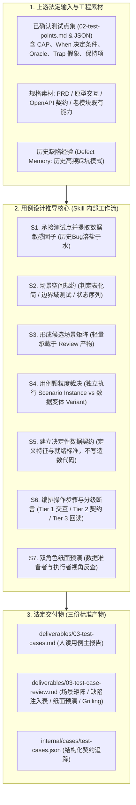
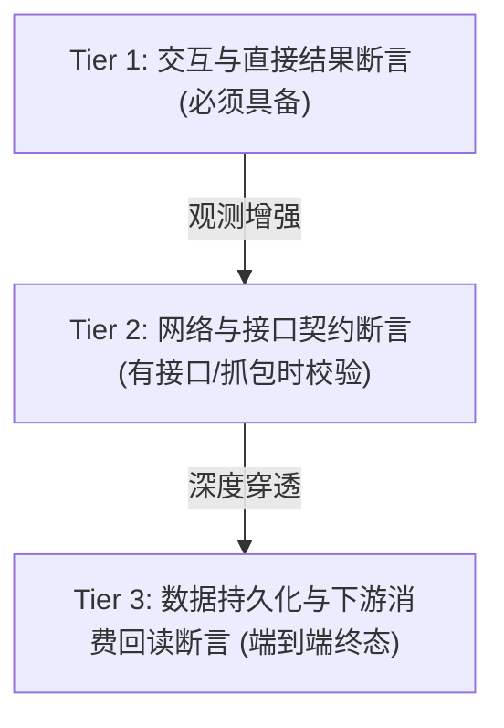

# test-case-design｜测试用例生成 Skill 终版改造设计方案（V2.0 实施基线）

> **文档状态**：终版实施基线（已融合开发期客观现实、上游测试点资产无缝消费、历史缺陷有机融入机制与分级断言策略）。  
> **制定日期**：2026-10-21  
> **上游对接基线**：原生消费 `test-business-modeling` V1.1 与 `test-point-design` V2.0 的法定产物（含基础核心能力 CAP 清单、成对证明边界 PB、决定性条件 When、实质预期 Oracle、假成功陷阱 Trap 与保持项 Must-Not-Change）。  
> **下游对接基线**：为 `test-data-readiness` 提供无歧义的数据契约与验收标准，为 `test-execution-runtime` 提供具备可观测性的操作步骤与断言，不越界编写具体造数脚本或自动化代码。  
> **核心定位**：**规格驱动与设计推导（Specification-Driven Test Design）**。在当前被测模块通常处于开发进行中、尚未具备完整源码、物理库表或运行接口的前提下，严格依据已确认的业务承诺与接口契约，开展严密的用例场景建模与断言编排。

---

## 0. 核心重塑：从“机械模板搬砖”到“场景工程化推导”

传统 AI 写用例的两大顽疾：
1. **假装自己懂技术实现**：在用例里凭空编造 `INSERT INTO...` 数据库语句、编写前端 `#submit-btn` 定位器或伪造根本不存在的接口 URL；
2. **假装业务完全正确**：看到一个测试点就机械套用“前置-步骤-预期成功”三段论，断言全是一字不差的套话（“操作成功”、“页面显示正常”），对假成功、状态脱节与副作用毫无辨别力。

本方案重构后的全流程演进流水线：



---

## 1. 关键突破：历史 Bug 如何参考才能“绝不生硬”？（溶盐于水机制）

很多团队让 AI 参考历史 Bug 时，AI 往往干出极其荒唐生硬的事情：
- ❌ **生硬反例 1**：机械照抄历史 Bug 单字面表象（例：“Bug #1089：张三上传财务报表.xlsx 第 32 行公式报错”，AI 就硬写一条用例：“上传张三的财务报表.xlsx，检查第 32 行公式不报错”）；
- ❌ **生硬反例 2**：无视当前业务上下文强行拼凑（把旧模块、甚至其他系统的冷门 Bug 强塞进全新的模块中，哪怕这个代码分支在当前根本不存在）；
- ❌ **生硬反例 3**：把历史 Bug 当作产品新功能（把历史缺陷修复产生的临时特定行为当成硬性标准预期）。

### 1.1 顶尖专家的处理哲学：缺陷模式抽象与变异因子注入（溶盐于水）

顶尖测试专家看历史 Bug，看的是**“这帮程序员在写类似逻辑时，最容易在什么地方犯糊涂”**。历史 Bug 绝不直接变成一条条独立的“历史Bug专项用例”，而是被抽象为**“数据敏感因子”**和**“反向检查点”**，有机融入到现有的主业务用例中：

```text
【历史 Bug 原始记录】
  "在用户管理中，删除用户后，由于 SQL 漏写 AND is_deleted=0，导致新建同名用户时误报已存在。"
       ↓ 
【步骤 1：抽象为缺陷机理模式 (Defect Pattern)】
  "软删除唯一性阻断缺陷：历史系统在存在软删除记录时，判重逻辑容易未能正确释放唯一性占位。"
       ↓ 
【步骤 2：提取为数据敏感因子 (Data Sensitivity Factor)】
  "因子名称：软删除前置记录干扰；特征：同名历史记录处于 is_deleted=1 状态。"
       ↓ 
【步骤 3：有机注入现有用例，而非单列生硬用例 (Organic Injection)】
  在已有的《TC-KB-CREATE-01 知识库创建名称唯一性校验》用例中，数据变体（Variant）自然包含一条：
  - 数据变体 1（常规同组同名）：目标组已有活跃同名知识库 → 预期拒绝；
  - 数据变体 2（常规不同组同名）：其他组有同名、本组无同名 → 预期放行；
  - 数据变体 3（★历史缺陷变异因子）：目标组存在已被软删除的同名知识库 → 预期放行并正常落库！
```

### 1.2 历史缺陷融入的三项铁律

1. **变异因子化（Factorization）**：
   - 历史 Bug 只能作为现有用例中**测试数据的变异参数（Variant）**、或者步骤中断言的**附加检查项（Checkpoint）**，严禁孤立单列“历史 Bug 验证用例”；
2. **同构机制准入限制（Relevance Filter）**：
   - 只有与当前业务机制具有**同构代码逻辑**的历史 Bug（如：同属于唯一性判重、同属于父子级联删除、同属于分页开闭区间、同属于异步状态流转），才允许提取因子；跨架构、无关 UI 样式的 Bug 绝对过滤；
3. **优雅留白原则（No-Hallucination Graceful Degradation）**：
   - 如果当前项目缺乏历史 Bug 库，或者当前功能是全新的独立业务、历史经验无法直接迁移，**必须坦诚留白，严禁 AI 凭空捏造虚假的历史缺陷来凑数**！在审查报告中注明“本期无强相关历史缺陷模式，采用通用启发式变异”。

---

## 2. 无缝咬合：如何直接消费上游 `test-point-design` V2.0 资产

上游测试点 Skill 已经经过深度重构，产出了极其清晰的结构化机制信息。用例设计阶段必须**直接消费、深度承接**，绝不重新发明轮子：

| 上游测试点要素 (`test-point-design`) | 在测试用例中如何直接转化 (`test-case-design`) |
|---|---|
| **基础核心能力清单 (CAP)** | **决定用例集的业务分组与导航结构**：用例严格按 CAP 归类，确保每个核心业务能力都有可执行的用例群承接。 |
| **决定性条件 (When)** | **具象化为确定性测试数据契约与前置状态**：将抽象的临界条件（如“目标分组已存在同名知识库”）细化为具体业务实体的 ID 关系、字段特征和状态就绪判定标准。 |
| **实质业务预期 (Substantive Oracle)** | **具象化为用例的主断言 (Primary Assertion)**：明确操作完成后系统实质产生的业务变化（状态跃迁、数据写入、回执信息）。 |
| **防假成功陷阱 (Superficial Trap)** | **直接翻译为用例的反假检查点 (Anti-Trap Checkpoint)**：上游已明确指出的伪成功表现（如“仅弹 Toast 但后台挂起”），直接作为用例执行过程中的必查项，未达物理标准绝不判定通过。 |
| **保持项 (Must-Not-Change)** | **直接翻译为用例的副作用保全断言 (Side-Effect Invariant)**：操作失败、被拒或异常中断时，强制核验哪些原有数据、关系和版本号绝对没有被脏修改。 |

---

## 3. 客观现实落地：分级断言策略（Tiered Assertions）

在软件工程实际交付中，**当前被测模块通常处于开发阶段，直接查物理数据库可能没权限、特定回读接口可能尚未开发完毕**。面对这种现实，不能一味要求“必须查数据库底层”，也不能退化为“只看页面弹窗”。

建立**三级断言策略**，明确不同环境可观测性下的断言边界与降级标记：



### 3.1 三级断言定义与标准

1. **Tier 1：交互与直接可观测断言（Baseline - 任何环境必须具备）**：
   - 界面元素状态：按钮禁用态切换、表单字段错误提示文案、卡片渲染位置、警告框弹出；
   - 交互反馈：明确的拒绝拦截提示、弹窗确定/取消交互行为；
   - **底线**：仅凭 Tier 1 不能断定后台事务完全成功，只能断定“前端交互契约达成”。
2. **Tier 2：网络与接口契约断言（Contract-Level - 具备接口/抓包能力时执行）**：
   - HTTP 状态码（200 / 400 / 409 / 403 / 422）；
   - 接口 Response Body 关键字段：`code == 'DUPLICATE_NAME'`, `task_id` 格式有效性；
   - **底线**：核对接口载荷是否符合 OpenAPI 契约，防止前端吃掉后端错误码。
3. **Tier 3：持久化与下游消费回读断言（Substantive Fact - 业务终极事实）**：
   - 业务回读：重新进入列表页、通过搜索接口查询、切换页面刷新后核对数据是否依然存在；
   - 下游消费：被处理的文档是否能被智能问答真实检索召回；
   - 保持项回读：被拒绝后，原分组下的原实体是否完好无损。

### 3.2 现实降级与向下游交接标记规范

如果当前阶段或当前测试环境**确实缺乏直接查询接口或物理数据库权限**，用例设计**严禁凭空捏造 SQL，也严禁假装已经验证通过**，必须在用例断言中打上清晰标记：
- 若 Tier 3 暂无法在本步骤直接验证，标记：`[Tier 3 观测需通过后续步骤或下游任务回读: 刷新页面重新检索]`；
- 若需要外部数据核验手段，标记：`[needs_environment_capability: 需要只读 DB 权限或审计日志入口]`；
- 这样交付给后续的 `test-execution-planning` 和 `test-execution-runtime` 时，执行人员清晰知道该用例是在界面层验证、还是需要配合接口抓包验证。

---

## 4. 全流程九步主工作流（S0 ~ S8）

整个用例设计在一个 Skill 内完成，绝不拆成 9 个子 Skill，保持操作的紧凑与高凝聚度：

### S0｜基线审查与上游资产摄入
- 读取已确认的 `01-business-understanding.md` 与 `02-test-points.md`；
- 检查版本一致性，按 CAP 能力对 TP 建立依赖索引；
- 摄入原始工程规格：PRD 章节、原型设计交互、OpenAPI 接口草案、已有系统老模块契约。

### S1｜双轨场景提取与缺陷模式抽象
- **业务主链轨**：根据 CAP 与正常业务流，提取支撑用户最终目标达成的正向场景与关键分支；
- **故障挑战轨**：承接 TP 的假成功陷阱与保持项，同时调取历史高频缺陷模式（软删除干扰、大小写敏感、首尾空格、时序竞争、分页越界），提取变异因子；
- 合并形成候选测试场景清单，标注场景类型（正向/反向/边界/容错）。

### S2｜选择并应用形式化设计方法（严禁虚假工具）
- **绝不使用**：在开发未完成阶段强行声称使用 Schemathesis、Hypothesis、Playwright Trace 等代码级工具；
- **切实应用**：
  - **等价类与边界域测试**：针对输入字段的长度、格式、字符集，推导有效类、无效类与临界值；
  - **判定表规约化化简**：针对多条件制约的业务准入逻辑，列出条件组合并化简消除不可能列；
  - **状态机迁移路径**：针对实体生命周期，推导合法跃迁与非法跃迁拦截路径。

### S3｜形成候选场景矩阵（落地于 Review 产物中）
- 为防止 AI 产生幻觉直接跳过推导填模板，强制在 `03-test-case-review.md` 中输出轻量级**《候选场景与变异推导矩阵》**：
  `场景ID → 对应TP-ID → 业务目标 → 决定性条件 → 注入的缺陷因子 → 预定用例形态(独立Case还是Variant)`。

### S4｜用例颗粒度与拆合裁决（明确判定标尺）
- **必须拆分为独立 Case (Scenario Instance)**：
  1. 核心业务预期本质不同（如：创建成功 vs 创建重名被拒）；
  2. 初始化前置状态不同、或异常恢复路径不同；
  3. 两个验证点之间存在测试遮蔽（前一个动作崩溃会导致后一个机制根本无法被执行）。
- **应当合并为同一 Case 的数据变体 (Variants)**：
  1. 业务操作动作序列完全一致、校验机制完全相同，仅输入数据取值不同（如：超长字符、特殊字符、负数等不同等价类样本）；
  2. 采用标准用例主体 + 数据变体表承载，避免用例数量虚假膨胀。

### S5｜建立决定性数据契约（不越界编写造数代码）
为每条独立场景或变体定义明确的数据契约，面向下游 `test-data-readiness`：
- **数据主体与关系特征**：租户 ID、所属分组、对象初始状态、关联实体唯一标识关系；
- **敏感数据特征**：明确指出需要包含的具体变异特征（如“同名但在历史库中已被软删除”）；
- **就绪判定标准**：数据准备人员通过什么依据判定数据已经完全就绪（例：“回读接口返回状态为 NORMAL 即视为就绪”）；
- **数据独占与清理要求**：是否允许并发共享、执行后是否被破坏、是否需要事务隔离。

### S6｜编排业务动作步骤与分级断言
- **步骤颗粒度**：按**“有业务语义的操作阶段”**切分（例：“选择目标分组并触发移动”），严禁拆解成琐碎的鼠标单击抬起；
- **步骤四要素**：`操作主体/入口 → 具体业务输入 → 操作动作 → 过程可观察变化`；
- **断言结构化编排**：
  - 核心步骤后必须包含**检查点 (Checkpoints)**；
  - 明确标注 **Tier 1 / Tier 2 / Tier 3 分级断言**；
  - 显式包含**防假成功断言**与**未变事实保持项断言**；
- **禁用占位套话**：严禁出现“操作正常”、“提示成功”、“按实际准备”、“查看相关日志”等无信息量废话。

### S7｜双角色纸面预演（质量自检门禁）
生成初稿后，由独立的自审上下文模拟两个下游角色进行纸面逻辑核对：
1. **数据准备者视角**：“根据这个数据契约，在不知道内部代码实现的情况下，我能不能根据业务入口把数据造出来？判定标准清不清晰？”
2. **执行人员视角**：“根据这些操作步骤，我能不能在界面/接口上完整走通？如果开发代码写错了，现有的分级断言能不能精准抓出来？会不会出现误报或假成功？”
预演发现的步骤断层或歧义，原地修订闭环。

### S8｜审查报告编制、文末集中澄清与交付
- 生成人类友好的用例主报告与审计审查报告；
- **文末集中澄清 (Grilling)**：若存在用例级排期范围取舍、数据准备代价争议或业务规则盲区，统一置于 `03-test-cases.md` **文末**，按决策树格式提供无偏见选项与影响分析；
- 交付最终用例基线。

---

## 5. 产物规范与真实范例

### 5.1 三份法定交付物分工

1. **`deliverables/03-test-cases.md`（人类可读用例主报告）**：
   - 包含：本轮范围、基础功能验收导航、按 CAP 分组的可执行测试用例（含操作步骤、分级断言与数据变体表）、文末集中澄清事项；
2. **`deliverables/03-test-case-review.md`（审计与推导底稿）**：
   - 包含：S3 候选场景矩阵、历史缺陷模式注入清单、拆合理由、双角色纸面预演记录、覆盖率对账；
3. **`internal/cases/test-cases.json`（机器可读数据契约）**：
   - 保持严格向下兼容，用于流水线解析、与测试点双向溯源、以及下游自动化工具消费。

---

### 5.2 真实实战用例示范（跨分组移动同名冲突与原子保全）

以下展示符合本规范的正式用例主报告片段：

#### 业务能力分组：CAP-WB-001 知识库分组与实体生命周期管理
**承接测试点**：`TP-KB-MOVE-01`（跨分组移动目标组重名拦截与状态保全）  
**关联历史缺陷模式**：DEF-PAT-03（移动被拒后，源实体关联数据发生半写入脏更新）

---

#### 用例编号：`TC-KB-MOVE-CONFLICT-01`
- **用例标题**：跨分组移动知识库在目标分组存在同名时的冲突拦截与零副作用原子保全
- **优先级**：P0
- **执行方式**：界面主操作（可辅以网络抓包）
- **用例目标**：验证当目标分组已存在相同名称知识库时，系统坚决阻断移动，并保证源分组归属与元数据零改动。

##### 【数据契约与前置要求】（面向数据准备）
1. **测试租户环境**：标准企业租户，操作者具备管理员权限；
2. **源数据状态**：
   - 分组 A：存在活跃知识库 `KB-Alpha`（ID: `KB_101`），包含 3 篇已解析关联文档；
   - 分组 B：存在活跃知识库 `KB-Alpha`（ID: `KB_202`，与源知识库完全同名）；
3. **数据就绪判据**：在管理界面分别能查询到分组 A 和分组 B 各自包含一个 `KB-Alpha`，且两者的实际 ID 独立。

##### 【操作步骤与分级断言】（面向执行人员）

| 步骤 | 操作入口与业务动作 | 预期结果与分级断言 (Checkpoints) | 观测级别 |
|---|---|---|---|
| **Step 1** | 进入知识库列表，在分组 A 下找到 `KB-Alpha` (ID: 101)，核对当前状态 | 知识库显示正常，明确归属于“分组 A”，下属文档数显示为 3 | Tier 1 (界面状态) |
| **Step 2** | 点击操作列中的【移动】，在弹出的分组选择下拉框中选中“分组 B”，点击【确定移动】 | **【直接结果断言】**：<br>1. 页面弹出明确的错误提示：“目标分组下已存在同名知识库，无法移动”；<br>2. 弹窗不强制关闭，允许用户重新选择；<br>3. *(接口观测)*: `PUT /api/v1/kb/101/move` 返回 HTTP 409 Conflict，Response Code 为 `DUPLICATE_KB_NAME` | Tier 1 (提示)<br>Tier 2 (接口) |
| **Step 3** | 点击取消关闭弹窗，刷新页面，重新查看分组 A 与分组 B 的知识库列表 | **【实质状态与防假成功断言】**：<br>1. 分组 A 下 `KB-Alpha` 依然完好存在；<br>2. 分组 B 下依然仅有原有的 `KB-Alpha` (ID: 202)，未增加新卡片；<br>3. 彻底排除“前端卡片被视觉移动至分组 B，刷新后才复原”的假移动陷阱 | Tier 1 (列表核对)<br>Tier 3 (回读) |
| **Step 4** | 进入分组 A 的 `KB-Alpha` 详情页，检查其下属文档列表与基础信息 | **【副作用与历史保全断言 (Must-Not-Change)】**：<br>1. 所属分组名称与属性完全保持为“分组 A”；<br>2. 下属 3 篇关联文档完好无损，未发生解绑或丢失；<br>3. 操作日志未记录虚假的“移动成功”事件 | Tier 1 (详情)<br>Tier 3 (关系保持) |

##### 【高敏感数据变体矩阵】（同一用例机制下的数据扩展）

| 变体编号 | 变体设计意图 | 输入数据特征变化 | 差异化预期断言 | 关联缺陷模式 |
|---|---|---|---|---|
| **Var-01** | 常规同名冲突（基准） | 目标分组存在同名字段完全一致记录 | 严格阻断移动，保持原状 | 基准业务规则 |
| **Var-02** | ★ 大小写与首尾空格敏感度 | 目标组已有 `kb-alpha`，源名称为 `KB-Alpha ` | 系统执行不区分大小写及 Trim 判重，依然坚决拦截 | 历史缺陷模式：大小写绕过漏洞 |
| **Var-03** | ★ 软删除历史干扰检验 | 目标组原同名知识库已被删除 (`is_deleted=1`) | **放行移动**！已删除名称不得占位，移动成功并落库 | 历史缺陷模式：软删除占位未释放 |

---

## 6. 与现有 Skill 仓库的平滑对接

1. **文件改造范围**：
   - `test-case-design/SKILL.md`：重排为 S0~S8 工作流，注入开发期现实定位、历史缺陷溶盐于水机制与分级断言标准；
   - `test-case-design/references/case-expansion.md`：细化场景展开与判定表化简；
   - `test-case-design/references/scenario-quality.md`：固化分级断言与数据契约编写标准；
   - `test-case-design/scripts/`：保持既有 JSON Contract 校验兼容，**绝不引入多余的 AI 自嗨单测**。
2. **原则底线**：
   - 不修改真实业务系统代码；
   - 不提交 Git；
   - 先行在当前工作区修改验证，未经指令不同步至外部安装目录。
