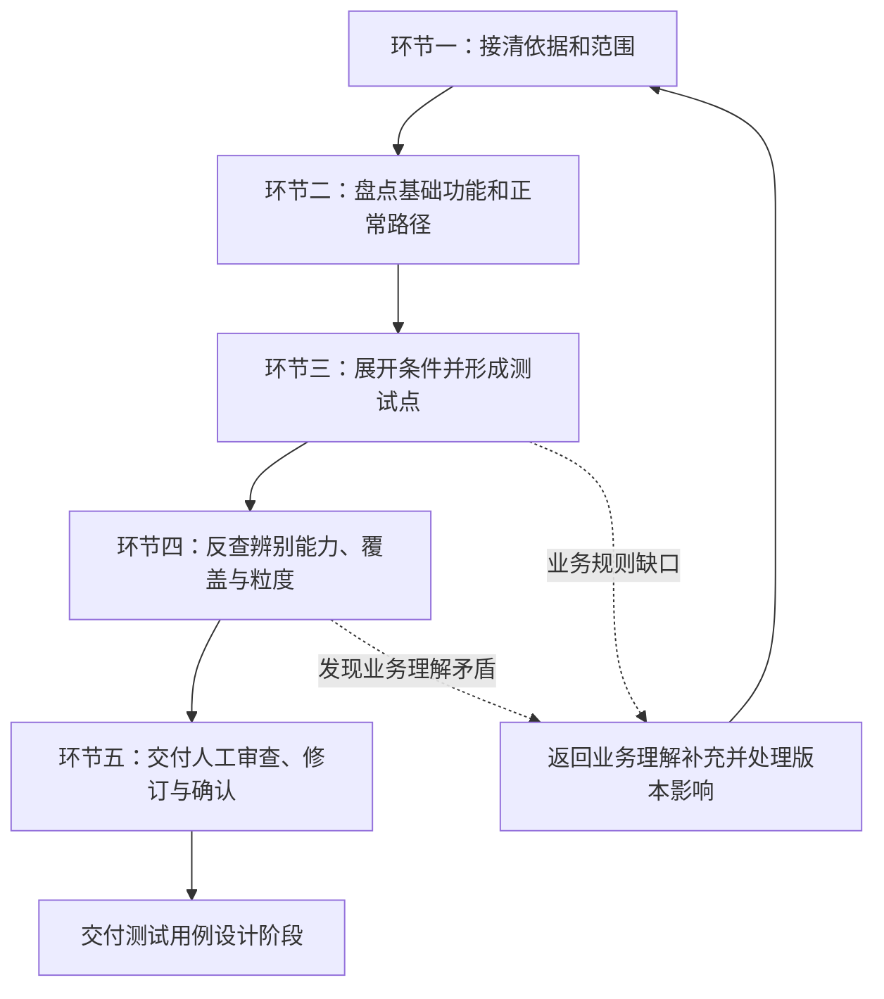

## 项目知识协作入口

处理具体项目工作前，读取 [项目知识读取与沉淀协议](../clarify-before-testing/references/project-knowledge-protocol.md)。该协议覆盖已有项目背景、非 Skill 材料接收、测试线选择和公共能力复用；本阶段职责仍由下文规定。


# Test Point Design｜测试点设计

## 1. 阶段定位与工作边界

本阶段在全流程中只解决一个核心问题：

> **哪些业务机制可能独立出错，因此必须单独进行验证？**

### 1.1 输入与输出

```text
【输入基线】
  1. deliverables/01-business-understanding.md（已人工确认的业务理解主报告）
  2. internal/business/business-model.json（同版本统一业务模型）
  3. 3.3 有效需求子句/关键路径/正反条件：evidence/effect-ledger.json（新正式运行必核对）
  4. 当前范围原始证据（PRD、设计稿、原型、已有接口约定、历史缺陷记录）
         ↓
【本阶段产物】
  1. deliverables/02-test-points.md（人工审查主报告：含基础功能导航、路径图解与机制测试点）
  2. deliverables/02-test-point-review.md（审查摘要：含自查与独立复核、错误挑战、重要排除与覆盖去向）
  3. internal/design/test-points.json（同一内部模型含 branch_design；用于追溯、契约校验与下游消费）
```

测试人员与业务专家主要阅读两个 Markdown 文件；内部 JSON 供自动化契约校验、版本绑定及下游工具解析使用。

### 1.2 客观开发背景与交接边界

1. **客观现实**：当前被测模块通常处于开发进行中，没有当前模块源码、实际数据库结构（DDL）或已完成接口是正常情况。测试点设计依据**已确认的业务承诺**开展，不以实现材料齐备为前提；
2. **测试点与用例分工**：测试点负责明确“在什么决定性条件下，验证什么业务机制，断言什么实质结果与防假象边界”；具体文件样本、账号密码、边界数值（如 1/50/51）、点击步骤、轮询时限与异常注入方法留待 `test-case-design` 阶段展开；
3. **观察手段的交接**：业务结果明确但具体观察接口尚未实现时，测试点注明“观察入口待落实”并交接给用例或执行方案，**严禁自行编造不存在的接口 URL 或数据库表名**；
4. **业务缺口归位**：发现规则缺失或业务冲突时，坚决返回业务理解阶段，不在本阶段私自替产品做主。

---

## 1.3 版本 1.1：严格保留旧能力，新增分支守恒（必读）

正式执行前依次读：

1. [10月9日以来测试点能力继承清单](references/version-inheritance-20261009.md)：明确哪些旧版方法不可退化；
2. [业务理解3.3交接规则](references/business-33-handoff.md)：从 `evidence/effect-ledger.json` 消费本期有效子句、关键链和判别式正反例，区分排除、替代、未决与外部依赖；
3. [独立业务分支、粒度与用例可展开性](references/branch-preservation.md)：新增“验证义务 → 决定条件/结果分支 → 测试点 → 用例”桥梁。

**正式新 Run 用 `schema_version: "1.1"`**；保留原 `coverage_obligations/test_points/design_questions`，在同一个 `internal/design/test-points.json` 增加 `branch_design`。旧 Contract 不修改，继续校验既有结构和双向引用；另外运行 `scripts/branch_audit.py` 检查分支的引用、原始子句效力、上下游承接和关键链终态。两项都通过仍不证明业务语义准确或已经完成独立审查。旧 1.0 产物允许旧 Contract 只读验证，但不能通过新分支审查门禁而被冒充成正式 1.1。

**特别关注真实生成效果**：旧版同一上游危险源模型得到 273/128 两组测试点，数量本身不能证明优劣。一个“协议完整性”TP 可以保留多个块位的条件变体；协议缺块、枚举非法、跨字段矛盾、重试片段拼接如果能分别出错，必须分别审查覆盖义务与拆点价值，不能都写成“协议校验正常”。

## 2. 现有能力完整保留矩阵

本 Skill 在重构后完整继承已有核心能力，严禁以流程优化为由削减关键机制：

| 原有核心能力 | 改造后如何保留与强化 |
|---|---|
| **上游输入基线与原始来源** | 完整消费已确认业务理解报告与模型；原始来源用于定向核对与防漏反查，不擅改已确认规则 |
| **全要素业务机制覆盖** | 事件、状态机跃迁、关系生命周期、不变量、业务规则、失败一致性、下游影响逐项有去向，不无故消失 |
| **正常主链与最终可用性** | 先盘点基础功能和主链导航，再展开异常专项；确保验证覆盖用户目标的真实达成 |
| **各类专项风险分析** | 输入规则、角色权限、范围隔离、旧状态、并发竞争、异步长链按适用性检查，不机械凑数 |
| **变化与不应变化项** | 按业务规则分别判断成功、失败和跨阶段过程中的变化与保持；包括引用、身份、历史及下游事实 |
| **原子机制与连续流程** | 区分 `atomic` 机制点与 `composite_flow` 复合流程点；连续流程不可替代中间机制覆盖 |
| **来源状态与推导约束** | 沿用 `CONFIRMED`、`DERIVED`、`TEST_BASELINE` 枚举；推导项严格说明推导来源 |
| **上游回退与版本失效** | 涉及业务规则变化时返回业务理解补充；沿用 Router 确认与下游产物版本失效机制 |
| **三份法定产物与同步检查** | 保持两份 Markdown 与一份 JSON 的法定产物体系；强制执行 `presentation_sync` 同步检查 |
| **结构契约与向后兼容** | 严格通过 `test_point_contract.py` 校验；保持旧版本数据的无缝向下兼容 |

---

## 3. 各种材料的用途与定向补查方法

### 3.1 材料用途划分
- **当前 PRD、原型与有效裁定**：确定用户行为、业务规则、决定性条件与正反两面结果；
- **已确认业务模型**：承接任务、能力索引、实体关系、不变量底线与依赖拓扑；
- **已有基础设施与公共能力代码/文档**：查清当前功能依赖的鉴权逻辑、对象关系、公共约定与调用风险，不通读全库；
- **当前模块接口或技术设计（若有）**：获取已确定的物理输入输出与观察锚点；未经业务确认的设计不冒充业务标准；
- **当前模块源码与执行证据（若有）**：辅助发现隐藏分支与实现风险，但不作为必备前提；当前实现不自动等于正确预期；
- **历史缺陷记忆库与复盘记录**：查找容易遗漏的边缘条件、伪成功陷阱与历史高频 Bug。

### 3.2 资料定向补查方法
当面临具体机制疑问时，严禁盲目大范围检索，必须按五步法进行定向补查：
1. **提出具体问题**：例如“当前模块调用已有实体选择器，停用实体是否仍可能被旧页面提交？”；
2. **选择目标材料**：锁定对应的接口契约文档、依赖模块设计或历史缺陷复盘；
3. **关键词定位**：通过全文检索快速定位相关段落、数据字典或图表；
4. **阅读完整上下文**：核对适用版本与约束前提，不孤立摘录单句；
5. **带回结论与去向**：将明确的条件纳入测试点，若仍存在规则空白则登记为待澄清问题。

---

## 4. 核心工作流程（五大工作环节）



### 环节一：接清依据和范围
- **输入**：已确认的业务理解主报告、业务模型 JSON 及有效原始素材。
- **工作**：
  1. 核对本轮测试的任务范围、排期版本、操作角色、实体依赖与既有裁定；
  2. 从能力索引展开到具体业务事件、规则、迁移、关系和流程，定位核心判定依据；
  3. 按 3.3 effect-ledger 中 active/excluded/superseded/unresolved/dependency 逐子承诺对账；区分已确认事实、合理推导、范围排除项及业务未决项；
  4. 对存疑机制开展定向补查，避免重复询问已有既定答案的问题。
- **输出**：本轮分析边界、适用事实、依赖拓扑与问题处理去向。
- **完成条件**：清晰界定“本轮测什么、不测什么、依据是什么”；未决业务缺口已标明受影响范围，不阻塞独立部分的继续推进。

### 环节二：盘点基础功能和正常路径
- **输入**：已确认的业务任务、功能入口与关联实体。
- **工作**：
  1. 按用户真实目标串联业务入口、前置条件、主要操作、关键分流与交付结果；
  2. 建立《基础功能验收导航》，反查需求和原型中实际存在的常规活动：单条件查询、组合筛选、重置、分页翻页、详情回显、编辑更新、状态启停、删除归档、批量操作与历史记录；
  3. 承接 3.3 critical_paths，明确正常路径中各阶段的中间产物、失败/停止/再进入终态，以及业务结果何时允许被下游或用户正式消费；
  4. 用业务路径图与通俗说明建立整体脉络（参见 [设计技术](references/design-techniques.md)）。
- **输出**：基础功能验收导航骨架、正常业务路径图解及各功能去向清单。
- **完成条件**：人工一眼即可看出是否遗漏整块基础功能；常规维护操作未被长链流程掩盖。

### 环节三：展开条件并形成测试点
- **输入**：功能骨架、已确认规则与业务不变量。
- **工作**：
  1. 识别改变业务行为或结果的关键条件：输入有效/无效特征、作用域（租户/角色/分组）、对象生命周期状态、配置保存与实际采用时机、异步阶段与依赖失败；
  2. 每个测试点写清**业务机制与触发动作、决定条件和实质结果**，其余内容按适用性展开：
     - **业务机制与动作**：验证哪项承诺，通过什么动作或事件触发；
     - **决定条件**：哪些输入、状态、角色或其他条件决定分支；
     - **实质预期**：什么业务结果说明承诺成立，不要求所有点都发生物理数据变化；
     - **保持项**：成功、失败及跨阶段过程中，哪些身份、关系、历史或其他事实按规则必须保持；例如成功编辑基础信息不应改变引用关系，成功回滚内容仍需保留历史；
     - **防假成功与观察要求**：高风险点说明哪些表面现象不足以证明结果，以及需要观察的事实（参见 [结果风险](references/outcome-risk-design.md)）。普通点不强造复杂陷阱或底层观察步骤；
  3. 先产出明确的覆盖义务，再按 [分支守恒方法](references/branch-preservation.md) 建立决定性条件→业务结果分支；一个 TP 可关联多个不同分支，但所有会改变结果的分支必须保留并为用例写出 variation_axis/data_condition/oracle；
  4. 对 3.3 的已确认 discriminators 两侧逐一承接，兼顾正常放行与违规拦截（如同组冲突拦截、跨组同名放行）；无法确定的输出只登记问题，不擅造预期。
- **输出**：结构严密的机制级测试点集。
- **完成条件**：下游用例设计无需重新脑补业务规则；测试点绝非业务标题或覆盖标签的换皮重复。

### 环节四：反查辨别能力、覆盖与粒度
- **输入**：候选测试点集、有效来源及历史风险点。
- **工作**：
  1. **高风险点错误挑战**：对异步长链、状态跳变、权限作用域等高风险点，假设开发写出合理的错误实现，反查当前测试点的条件与预期是否真能表现出差异；
  2. **遗漏与测试遮蔽反查**：
     - 检查上游所有事件、规则、关系生命周期是否逐项有明确去向（[Coverage Types](references/coverage-types.md)）；
     - 检查前置条件是否能真正触达被测机制（前置校验失败不得遮蔽核心持久化缺陷）；
  3. **义务/分支/TP 双向反查**：每项有效业务子承诺、3.3 正反条件、关键链中断与交错都有去向，任何合并不得吞掉重要分支或用例必要变体；高风险点必须能说出伪成功怎样被识别；
  4. **粒度判断**：
     - 结合业务目标、决定条件、结果及分别判断风险的价值决定拆合；可独立出错只是线索，不按猜测的代码结构机械拆点（[粒度规范](references/test-point-granularity.md)）；
     - 记录重要的排除、归并理由；不因“已有唯一索引/状态机声明”直接免测；
  5. **独立复核**：由实际独立上下文先读相同有效来源、已确认模型、范围和裁定，形成关注点，再读取候选测试点。输入包含后来查明的依赖资料，不仅是生成者摘要；按宿主可用工具派发，不写死工具名；
  6. **修订与复核**：重要发现记录来源、候选位置、问题、影响、处置依据和复核结果。生成者修订后，由复核者读取实际变化，检查直接与间接依赖、原有正确事实和三份产物同步；适用时再运行结构校验，不能以脚本通过替代内容复核。
- **输出**：经得起攻防挑战的测试点集、修改记录与覆盖对账表。
- **完成条件**：高风险机制的条件与预期能区分所假设错误；重要发现均有处置或明确未决去向，修订已实际复核，拆合与覆盖依据可查。无法取得独立上下文时继续自查、保存候选并注明“独立复核未完成”；同一 Agent 换角色不能算独立复核，也不能据此标记已通过或正式放行。

### 环节五：交付人工审查、修订与确认
- **输入**：完成自查与独立复核的候选产物，以及整理好的未决事项。
- **工作**：
  1. 对基础/状态/权限/长链/AI效果等不同类型测试点做**用例可展开性抽查**：能说清数据条件、条件变体、动作、业务断言及观察边界，不能只得到“点击后正常”；不代替完整用例生成。
  2. 按人类友好顺序编排交付物（[报告交付规范](references/human-readable-reporting.md)）：
     `范围与基础功能导航 → 业务路径图文讲解 → 按任务分组的测试点 → 风险限制 → 文末待确认问题`；
  2. 主报告使用通畅的中文业务标题，重要条件与断言默认可见，消除理解障碍；
  3. 在 `02-test-points.md` **文末集中呈现待确认问题**，先核对来源与已有回复，交代场景、已知事实、缺口及决定后果。已知可行方案才给选项，方案空间不明时开放询问；缺乏推荐依据时标记 `not_recommended` 并说明原因；无待确认问题也明确说明；
  4. 收到反馈后区分业务裁定、事实纠错、临时口径、范围调整与正式确认。按影响同步正文、图、审查摘要和 JSON，并重新复核；涉及业务规则变化时先返回上游同步，检查版本及下游影响。问题回复不自动等于最终确认；
  5. 人工正式确认后，按流程锁定版本，进入测试用例设计阶段。
- **输出**：三份同步更新的法定交付物。
- **完成条件**：正文和问题不依赖内部代号即可理解；按第 7.2 节处理完设计问题与待确认覆盖，保留其余执行限制并取得人工正式确认。AI 自查或复核不能代替人工确认，确认设计也不代表产品已经执行通过。

---

## 5. 内部模型结构与来源状态约束

内部 `test-points.json` 保持严谨结构，向下兼容既有规范；**1.1 增加 `branch_design`（详细字段见 [分支守恒方法](references/branch-preservation.md)）**。原有 TP 字段不变：

```text
coverage_obligations:
  - coverage_id: 唯一标识
    description: 验证义务描述
    source_model_refs: [上游业务事件/规则/关系/迁移ID]
    type: 18类Coverage枚举之一
    status: covered | not_applicable | out_of_scope | pending_confirmation
    test_point_ids: [承接的测试点ID]
    reason: (排除/不适用时必填)
    question_id: (pending_confirmation时必填)

test_points:
  - tp_id: 唯一标识
    priority: P0 | P1 | P2
    granularity: atomic | composite_flow
    module_id: 业务模块ID
    business_object_ids: [关联业务对象ID]
    business_event_ids: [关联业务事件ID]
    primary_coverage_id: 主承接覆盖项ID
    source_coverage_ids: [所有关联覆盖项ID]
    mechanism: 业务机制名称与目标
    preconditions: [前置与关键决定性条件]
    core_expected: 实质业务预期断言
    affected_facts: [该动作或事件按规则应变化的业务事实，包括适用的失败状态]
    must_not_change: [成功、失败及跨阶段过程中按规则应保持的身份、关系、历史等事实]
    downstream_impacts: [对下游或消费端的派生影响]
    source_status: CONFIRMED | DERIVED | TEST_BASELINE
    derived_from: [DERIVED状态下必填推导依据]
    source_refs: [原始PRD/设计稿等证据引用]
    cohesion_rationale: (atomic跨多个覆盖项时必填归并理由)
```

能力索引只作导航，覆盖项引用当前合同可识别的实际机制 ID；不将能力编号直接填入 `source_model_refs`。保留覆盖项与测试点的双向关联、主覆盖项、`DERIVED` 推导依据和现有同步字段；阅读形式变化不改变合同或新增确认状态。

---

## 6. 人工交付物组织要求

详细交付格式严格遵循 [Human-Readable Reporting 规范](references/human-readable-reporting.md)：

1. **`deliverables/02-test-points.md`**：面向业务人员与测试人员。提供基础功能验收导航、业务路径图文说明、按任务分组的测试点明细、剩余限制及文末集中待确认问题；
2. **`deliverables/02-test-point-review.md`**：面向质量负责人。记录本轮发现并修正的问题、高风险机制错误挑战记录、重要排除与归并理由、18 类机制覆盖对账及进入下一阶段建议；
3. **语言定性底线**：严禁把本阶段未执行的代码推演标注为“PASS”、“已复现”或“已验证通过”。

---

## 7. 契约校验与正式确认门禁

### 7.1 结构校验命令

候选结构完整后，运行自审校验；允许如实保留待确认问题：

```bash
python test-point-design/scripts/test_point_contract.py \
  --input internal/design/test-points.json \
  --business internal/business/business-model.json \
  --allow-waiting-confirmation
```

同一份 JSON 还必须运行分支/上游有效子句审查（候选阶段可不加 `--strict`；其结果不能冒充最终完成）：

```bash
python test-point-design/scripts/branch_audit.py \
  --input internal/design/test-points.json \
  --business internal/business/business-model.json \
  --effect-ledger evidence/effect-ledger.json
```

在提交人工最终确认前，运行全量门禁校验：

```bash
python test-point-design/scripts/test_point_contract.py \
  --input internal/design/test-points.json \
  --business internal/business/business-model.json
```

还须在最终确认前运行：

```bash
python test-point-design/scripts/branch_audit.py --input internal/design/test-points.json --business internal/business/business-model.json --effect-ledger evidence/effect-ledger.json --strict
```

如果 3.3 没有真实有效子句账本，不能造文件凑通过；候选可标注受限，正式流转暂停。代码只查关联结构和已声明的范围冲突，仍需真人/隔离上下文语义核查。

### 7.2 进入用例阶段的收口门禁

在正式流转至 `test-case-design` 之前，必须同时满足以下条件：
1. **版本一致**：测试点记录的 `business_model_version` 与当前已确认业务模型的 `model_version` 一致；
2. **覆盖闭环**：业务模型中的核心事件、规则、关系与流程均有明确覆盖去向，无待决覆盖项（pending_coverage 必须清零）；
3. **问题清零**：所有测试点设计问题均已回复解决（pending_questions 必须清零），且无未闭环的 `return_to_business` 问题；
4. **粒度通过**：粒度自审无遗留的 `overbroad_point_ids` 或 `data_instance_split_groups`；
5. **文档同步**：三份产物内容一致，`presentation_sync` 各项校验均为 true；
6. **分支保持与用例承接**：`branch_audit.py --strict` 已执行，正反/失败/并行变化条件分别可验证，高风险 TP 的数据条件与业务判定依据可交给用例，抽查问题已回写；
7. **人工正式确认**：取得用户对正式测试点产物的明确确认。

独立复核必须按环节四实际完成；其未完成状态不能由自审标记或人工确认替代。结构校验只证明相应字段、引用与状态满足合同，不证明业务完整性或实际执行结果。
