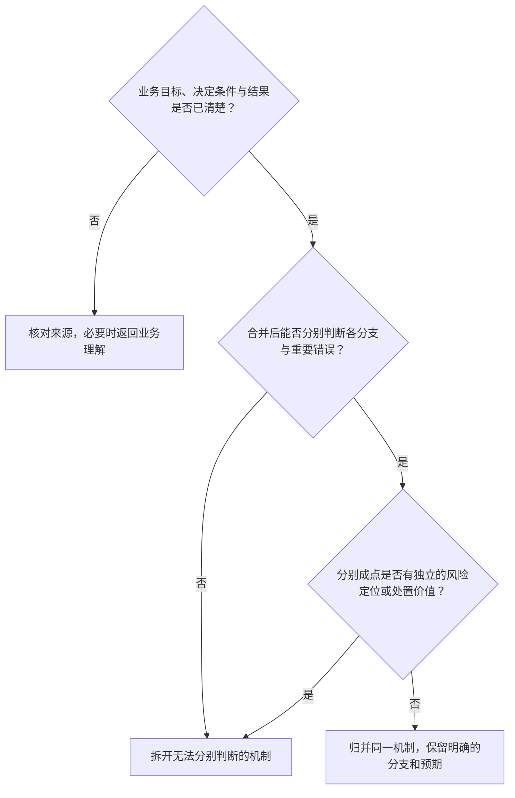

# Test Point Granularity 测试点粒度与拆合规范

本规范定义机制级测试点（Test Point）的粒度判别标准、拆分合并准则以及组合排除的裁决依据。

---

## 1. 核心概念分层与边界

必须严格区分机制、分支、执行实例与连续流程，避免概念混淆导致的粒度失控：

```text
┌─────────────────────────────────────────────────────────────┐
│ 1. 业务机制 (Mechanism)                                      │
│    一个可以独立发生正确或错误结果的代码/业务逻辑单元。       │
│    例：跨分组移动时的目标组名称唯一性校验机制                │
├─────────────────────────────────────────────────────────────┤
│ 2. 条件分支 (Condition Branch)                             │
│    同一机制下导致不同确定性走向的业务分流。                  │
│    例：目标组已有同名（拒绝） vs 目标组无同名但其他组有（放行） │
├─────────────────────────────────────────────────────────────┤
│ 3. 执行实例 / 数据样本 (Execution Instance)                  │
│    同一机制与分支下具体的参数取值、账号、边界值或测试数据。  │
│    例：名称长度为 1、50、51，特殊字符，用户 A、用户 B        │
│    👉 【严格属于测试用例阶段，本阶段严禁为每个样本拆测试点】 │
├─────────────────────────────────────────────────────────────┤
│ 4. 连续流程 (Composite Flow)                                │
│    串联多个已存在原子机制，验证跨步骤数据传递与最终一致性。  │
│    例：从上传排队到分块、索引并最终可被检索的端到端主流程     │
│    👉 【不可替代原子机制覆盖，必须具备独立的连续性风险】    │
└─────────────────────────────────────────────────────────────┘
```

---

## 2. 按业务目标、条件与判断价值决定粒度

先确认业务承诺、决定条件和结果，再判断合并后能否分别识别关键分支与错误。结果可以独立出错是检查线索，不是按代码结构强制拆点的算法；没有当前模块源码也能进行此判断。



例如同一名称规则的同组冲突拒绝、跨组同名允许，可以共同描述为“唯一性作用域”，但两种条件和结果必须分别明确。不能因为二者可能由不同代码分支实现就强制拆点；也不能只留一句“判重正确”。原子点跨多个覆盖项时，继续提供 `cohesion_rationale`；业务机制、影响或预期实际不同的内容不能借归并省略独立判断。

### 建议拆分的情形
1. **多重独立业务承诺**：一个操作同时承诺了主记录创建、统计值累加、审计日志记录、下游消息广播，这些结果可以独立实现错误；
2. **不同生命周期状态下的行为差异**：同一动作在 DRAFT 态下直接保存，在 AUDITING 态下生成变更单，机制不同应拆分；
3. **准入校验与失败原子性**：操作被拒的业务拦截逻辑，与被拒后原有事实不被脏写的原子性机制，可独立出错，建议拆分；
4. **配置持久化与后台执行采用**：前端配置保存成功，与后台 Worker 实际按新策略运行，往往是两个完全独立的系统环节。

### 建议合并的情形
1. **同一约束下的不同边界数值**：长度 1、2、49、50 均属于同一种字符长度校验机制，合并为一条机制点；
2. **同一等价类下的多个数据样本**：中文名、英文名、带下划线名称，在同一机制下仅是样本差异，合并；
3. **完全相同的逻辑分支仅操作者不同**：在同一权限等级下，用户 A 和用户 B 操作相同，不按人头拆点。

---

## 3. 不能据已有外部约束免测的底线原则

在推导测试点时，**严禁将以下系统内部声称的防御手段作为“免测/无需验证”的借口**：

| 错误免测借口 | 专家的反思与真实风险（为什么必须测） |
|---|---|
| ❌ “网关层已经做了解析和拦截，业务层无需再测” | 网关路由规则可能配置错误、路由穿透或未校验内网调用；测试点需验证端到端真实防护。 |
| ❌ “数据库已经建了唯一索引，不可能重名，不用测” | 索引作用域与有效规则是否相符、拒绝结果是否正确、是否产生错误副作用，仍需验证；不预设软删除字段、错误码或索引结构。 |
| ❌ “状态机定义明确禁止从 DRAFT 跳到 SUCCESS” | 状态机代码实现中可能存在绕过跃迁表的隐式 RPC 或直接 UPDATE 逻辑。 |
| ❌ “前端界面没有这个按钮，用户点不到，不用测” | 界面不展示不证明其他入口不可达；结合已知业务入口与授权要求检查保护，不为不存在的接口虚构调用用例。 |

---

## 4. 重要的排除、归并与未覆盖项说明规范

在测试点审查摘要（`02-test-point-review.md`）中，对所有未展开、已排除或归并的重要场景必须给出合理解释：

1. **已由其他测试点承接**：指明承接的 `TP-ID`，说明共享覆盖点；
2. **机制等价归并**：说明业务条件、结果与影响为何等价；可参考已知实现辅助判断，但“同一正则”不能单独证明业务等价。明确哪些样本差异留给用例阶段参数化；
3. **业务范围外 (Out of Scope)**：给出明确的业务理解排期证据或 PRD 版本排除条款；
4. **当前不可达或环境无法构造**：给出技术证据、环境限制说明及遗留的残余风险；
5. **暂无足够依据**：如实登记为待确认问题，**严禁伪装为“无需验证”**。

> [!NOTE]
> 我们不追求对所有输入可能做毫无意义的庞大笛卡尔积台账，但必须对**影响业务覆盖判断的关键取舍**建立清晰的解释去向。

## 1.1增补：测试点可合并，决定性分支不能消失

沿用本文件的独立正确性机制定义；实际判断前再读 [分支守恒方法](branch-preservation.md)。旧版把“每个独立失败”拆过细与新版把不同校验责任宽泛合并都不是目标：先列出正确性义务及条件-结果分支，再决定是否独立成 TP。可归为同一 TP 的多个相似输入仍须在 `case_handoff.required_variations` 中保留由有效原文明确要求的不同位置、对象状态或适用范围；不可默认为“用例阶段自然会想到”。
