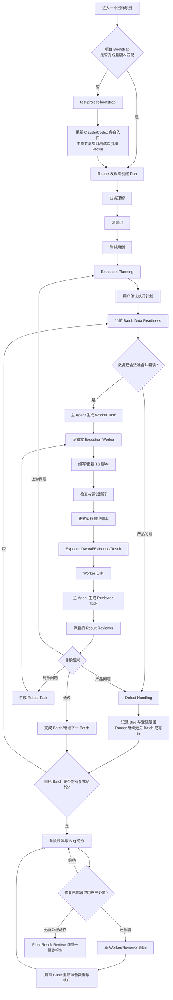

# 新版测试 Skill 改造计划

> 状态（2026-09-28）：下方带日期的 Phase 记录是历史证据，不代表当前 checkout 已通过新版验收；实施者须先核对当前 Git 状态、文件、Contract 和可复核产物，不得重写已关闭的 Run。此前 Codex/Gemini 目录覆盖是历史操作，不构成本次再覆盖授权。本次新确认的执行规划→数据准备→Runtime/Jev→缺陷回归→最终报告设计尚未实施；Jev 真实调用仍须单独通过数据、预算与环境门禁。
> 目标仓库：`C:\Users\17381\Desktop\测试全流程skill`
> 改造策略：直接升级当前版本，不保留旧执行契约兼容层；完成验收并经用户确认后，再覆盖同步到实际 Skill 安装目录。
> 本文是本轮改造的事实源。实施中若要改变冻结决策，必须先更新本文并说明理由，不能边改边改变架构。

### 2026-10-08 用户纠偏：复用已有业务用例，不重新设计

依据用户最新明确指示，本节优先于下方本日自行构建fixture的执行安排。此次改造的主验收复用已有仓颉知道知识库用例与已批准、已实际跑过的 `TC-KB2-CURRENT-001` 关键字场景；不重新做业务理解、测试点或用例设计，不将自建“草稿/激活/发布”场景当作主业务。范围整理见 `docs/verification/2026-10-08-existing-business-case-scope.md`。

允许在用户已给定环境复用既有只读业务场景；脚本与新证据仍放本仓库，不修改真实业务项目源码/既有用例或旧冻结Run。缺陷工具模拟验收与真实Case结果必须分账；模拟单明确非真实产品缺陷，不能伪造真实FAIL/PASS_AFTER_FIX或宣称修复回归已经验收。停止推进Oct08新建fixture的测试点确认，不删除或回写已存在历史。

### 2026-10-08 本轮验收范围与调用授权变更

本节依据当前用户明确指示，优先于下文历史双宿主验收要求；只收窄验收宿主，不降低业务闭环或证据要求。

- 本轮只验 Codex。场景 22、29、31 及 Phase 6/8.4 中的 Claude 实际发现/派发要求不再作为本轮必过项；它们对应的 Codex 行为要求仍保留。Claude 入口资产可做静态安全检查，但不宣称 Claude 宿主已验收。完成定义中的“双宿主”在本轮解释为 Codex，不删改历史证据。
- 用户已授权由 Agent 直接进行 Jev 实测，无需逐次或重复请求批准。沿用本地现有 TypeSafe 官方密钥，仅允许本仓库隔离 fixture 的合成、脱敏 UI 候选及 API 响应数据外发；不发送业务账户、密码、密钥、真实业务数据或聊天正文。不切换 provider、不隐式自动重试。
- 授权不是无限花费：首批设请求上限 20 次、总预算上限 USD 1.00，单请求上限 USD 0.05；基线/指标/输入与停止条件须在请求前冻结。遇无法核对费用、超时、鉴权失败或协议异常即停相应路径并保留证据；如需扩量，应先报告已有结果，不擅自扩大。
- Phase 8 的基础闭环前置条件保持：先通过当前契约的故障、修复部署、回归与受阻恢复，不以少量 Jev 连通请求代替整体验收。
- 禅道 MCP 已实际检查可连接并认证，具备提单及回读能力；真实问题须证据核实与查重后按已绑定项目提交。故障注入 fixture 不属于真实业务产品，不得往真实产品项目塞入冒充业务 Bug 的验收单。
- 不覆盖全局 Skill，不操作真实业务项目，不重写旧关闭 Run。阶段确认和用户延期决定仍须真实记录；新的独立 Worker/Reviewer 不得冒充新主聊天恢复。

### 2026-09-28 后半程流程决议与实施边界

以下决议是当前实施目标，优先于下方历史验收记录及仍描述旧行为的段落；实施时还必须同步修改相应 Skill、Contract、Router、测试和本文对应章节，不能只靠这段文字形成兼容层。

- 一个测试 Run 从执行规划一直覆盖初测、等待修复、多轮回归、受阻 Case 恢复和最终报告。新开聊天优先恢复同一未关闭 Run；所有 Batch 首次得到经复核的执行/受阻结论后生成**阶段快照**，不因此关闭 Run，也不冒称最终报告。
- 项目 Bootstrap 登记缺陷平台连接能力、字段映射及非敏感默认值；Execution Planning 为当前 Run 绑定具体平台项目、目标环境/版本、执行方式、Batch、证据与 Jev 决策策略。Data Readiness 才确认真实账号/秘密引用并准备、回读和绑定基础数据与当前 Batch 数据；Runtime 消费这些绑定，不重新选择。
- Jev 是否用于某条步骤或 Expected 由 Planning 以 `required | conditional | none` 和有界输入、触发条件、失败路径、费用上限决定；API 与 UI 按**是否存在有限语义判断**而非执行驱动筛选。普通确定性断言不调用 Jev。脚本必须在首次正式执行前写好；Jev 不编写脚本、不生成任意操作、不单独判 Case PASS。
- 数据准备与正式 Runtime 发现的疑似产品问题进入同一套诊断、合法复现、查重、提 Bug、关联范围与修复验证流程，但保留来源类型；未执行 Case 不得伪造成 Runtime FAIL。Bug 修复必须确认部署到目标环境后才能回归。用户在修复对话明确标记“延期/无需修复”是正式处置，不再要求第二次批准；保留失败/受阻事实及风险。
- 最终复核只在无待回归、待恢复执行、待独立复核等未处理动作时进行；延期/无需修复不是 PASS。最终报告必须区分初测与各轮修复、最新目标版本和旧版本证据、未测范围及剩余风险。Run 关闭后报告冻结；后续再修复延期 Bug 用关联新 Run，不回写旧结果。
- 不保留旧执行契约兼容层。新规则先只在当前仓库与隔离 fixture 实施；不得因历史覆盖记录再次覆盖全局 Skill 或修改真实业务项目。每阶段有对应负向/正向验证和独立审查，最后要有真实 API/UI smoke、宿主 Worker→Reviewer 派发与实际 Jev 路径证据。

### Phase 6 实施发现：Case Design → Planning 投影

正式 Router Run `PHASE6-RUNTIME-003` 证明当前 Case Contract 产出 `case_templates` / `execution_instances`，而 Execution Planning 与 Final Review 只消费顶层 `cases`；确认的 Case 文件直接交给 Planning 时会得到空 Case 集并拒绝。此为计划与现状的 producer-consumer 断点，不改变本计划冻结的业务规则或自动化栈决策。

最小修正：由 `test-case-design/scripts/case_contract.py` 提供确定性、不可手工编辑的 Runtime Case 投影；每个 `execution_instance` 生成独立 Runtime Case，Expected 只取该实例映射的断言，模板必须明确提供 `target_action`。Router、Execution Plan CLI、Final Review 均须从已绑定的原始 Case Design、Test Points、Business Model 重新严格校验并调用同一投影函数；Execution Plan 仍以完整 Case Design 文件 SHA-256 绑定确认版本。不新增旧格式 fallback，不在源 Case 文件中维护第二份可编辑 `cases` 真相。此投影是实现层的确定性规范化，不另设人工确认决策。Planning 中发现并修订上游 Case 时，Router 还需允许带原因返回 Case Design；重新注册新版 Case 后自动清除失效的下游计划/数据确认。

后续合同审查补充：`step` 与 `intermediate` Expected 必须绑定本 Case 内明确的 `step_id`，并原样进入 Runtime Plan；证据等级、录屏布尔值和 Expected 映射必须从机器可读 `evidence_policy` 投影，Planning 不得弱化。参数化模板的策略映射按每个实例实际承接的 Expected 过滤，同时确保每个必需证据断言至少进入一个实例；证据 kind 在 Case Contract 阶段枚举校验。Planning/Final Review 还必须分别验证 Router 注册的 Case 展示文件、合同文件、Review 文件和确认绑定的路径及 SHA-256 均当前一致。

Runtime 证据绑定补充：当 Planning 将 `runner_report` 列为某 Expected 的必需文件证据时，该 Expected 必须引用与 `automation_run.official_run.report_ref` 同一份官方 JSON 报告；只验证另一个独立的官方报告存在不足以满足逐 Expected 证据策略。

`runner_report` 只适用于自动化 Case；人工 Case 的必需证据不得要求官方自动化 Runner 报告。

截图执行校验补充：Planning `screenshots[].expected_ids` 中的每个 Expected 都必须在自己的结果行引用图像证据；中间检查点要按步骤时序采集，不能仅凭执行后的最终画面倒推先前状态。

### Phase 6 最终验收记录（2026-09-23）

- 正式 Router Run：`.phase6-forward/fresh-project/work/test-runs/PHASE6-RUNTIME-003`。B01 的 3 个冻结 Case（API 1、普通 UI 1、critical UI 1）由独立 Codex Execution Worker 执行、另一独立 Result Reviewer 复核；全部 Expected 与脚本、Runner 报告、截图/录屏完成 hash 绑定。Run 级 `test-result-review/scripts/final_review.py` 返回 `ok=true`、3 Cases、`conclusion=ready`；Router 已绑定真实 Final Review 文件并进入 `closed`。
- Contract 修正：Runtime 不再要求原样官方 Runner JSON 报告带 API 请求响应的 `redacted:true`；单独的 request/response JSON 仍必须声明脱敏。针对该边界的 Runtime Contract 验证为 15 passed。
- 全新 Claude Code 前向验收：Run `.phase6-forward/fresh-project/work/test-runs/PHASE6-CLAUDE-002`，主会话 UUID `78a70fb9-7812-490b-81a5-43ed2337357d`。主会话原始 stream 中记录到两次有序且不同类型的真实 Agent tool 调用与宿主完成事件：`test-execution-worker` Agent `a3b3b4bffbb1f6316` 完成后，才派发 `test-result-reviewer` Agent `a647bb808ce9de874`。Reviewer 独立确认 API/Vitest 与两条 UI/Playwright Case 全部 PASS；验证脚本先于首次 Case 运行、哈希一致、关键 UI 前后截图不同且录屏有效。
- 前向验收完整账本：`.phase6-forward/fresh-project/work/test-runs/PHASE6-CLAUDE-002/final-ledger.md`；实际 Agent 调用证据：`.phase6-forward/fresh-project/work/test-runs/PHASE6-CLAUDE-002/runner-results/claude-main-stream.jsonl`。所有本轮修改/运行均限于当前仓库隔离 fixture，未改真实业务项目或全局 Skill 安装目录。
- Phase 7 不在本次授权范围内：只有用户明确确认当前仓库版本满意并授权覆盖同步后，才可修改全局 Skill 安装目录。

### Phase 0–6 独立复核与修正（2026-09-24）

- 当时记录的全量 `python -m pytest -q` 为 91 passed、1 skipped，Phase 6 Router Run `workspace_validate.py` 与 `final_review.py` 重验通过；这是先前状态的历史证据，不等于当前 checkout 仍可复现。
- Phase 4 局部 Retest 当时的证据路径为 `.phase3-smoke/project-20260923-145036-374957/work/test-runs/PHASE4-RUNTIME-SMOKE`；该目录当前缺失。
- Phase 5 两个历史 Run 当时据记录包含并行 Batch、PASS_AFTER_FIX 和 BLOCKED 恢复链路，但被 Final Review 的 `test_cases_self_review_passed` / `test_cases_confirmed` 标记拒绝；本次 checkout 找不到两份 Run、Review JSON 或 `.phase*` 目录，无法重跑 validator。旧状态中的 `closed/passed` 不替代 Contract 复核。禁止对旧 Run 补写 flags 或重放；Phase 5 改为在新隔离 fixture 按本计划重新验收。
- 当时 checkout 曾缺少计划定义的 `test-project-bootstrap`；2026-09-24 已从删除前提交 `06d32e9` 恢复 18 个文件，并移除 `.gitignore` 中对该目录的忽略。只读独立审查认为恢复源码与 Router/Phase 8 边界总体一致，但 README 的目录计数已同步修正，Bootstrap 仍须在隔离项目上重跑首次初始化、幂等、冲突拒绝和 `--check` 前向验证，不能把源码恢复本身当作验收通过。
- Bootstrap 安全修正：写入前整体检查 Agent/TypeScript 公共骨架及 `.test-workflow` 索引/配置目标；拒绝 symlink/junction 和普通文件祖先路径，拒绝非本工具归属标记或不完整配置，也拒绝新项目已有非本 Skill 文件、索引/profile 或升级时本地修改的受管文件。仅接受明确标记为 `test-project-bootstrap` 的新版 Profile；无标记旧 Profile 不迁移、不覆盖，遵循不保留旧执行契约兼容层的冻结决策。补充归属标记篡改、旧 Profile 拒绝、后置冲突预检、普通文件父路径及链接测试；一般磁盘/权限等写入期故障不承诺跨文件事务回滚。
- 2026-09-24 恢复后的 Bootstrap/Phase 6 前向复验进度：在仓库内 `.phase6-forward/fresh-project` 隔离项目完成 Bootstrap 首次写入、二次幂等（`changed=[]`）、`--check` 和保留项目原 `CLAUDE.md`；冲突 fixture 验证已有项目自有骨架文件时在写入前整体拒绝。恢复源码由独立只读子 Agent 审查；README 已更正为“1 个项目 Bootstrap + 9 个流程 Skill”。
- 同一隔离项目已写入 1 条 Vitest + Node 原生 fetch API smoke 和 2 条 Playwright Test UI smoke。由真实、顺序分派的 Codex 子 Agent Worker 执行并自审，再派新子 Agent Reviewer 复核；最终 UI 两条通过，critical 截图和独立录屏可读。TC-UI-002 验证同一对象经页面 POST、刷新后的 GET read-back 仍为 1；当前服务端存储为进程内 Map，只证明本地 smoke 的服务端刷新读回，不代表数据库持久化。初次导入失败及后续夹具路由失败均保留在 `work/test-runs/PHASE6-RUNTIME-004/debug/attempt-001..003`，未覆盖。
- 以上仅为 Bootstrap 子集和 Codex 本地 smoke 的前向证据，不等于 Phase 5/6 完成：当前 smoke 尚未形成经正式 Router/Runtime Contract 校验的完整 Run、真实宿主 Runtime receipt/session 绑定；Phase 5 跨阶段 Regression/Blocked resume/Final Review 全链仍未复验；计划要求的新鲜 Claude 主会话 Worker→Reviewer 行为验收也未完成。因此 Phase 8 的 8.0/8.1 尚未开始，禁止越过前置条件或发出 Jev 请求。
- Phase 0–6 独立复核阶段未修改全局 Skill 安装目录或真实业务项目；Phase 7 的 Codex/Gemini 覆盖见下方记录。

### Phase 7 Codex/Gemini 覆盖记录（2026-09-24）

- 按用户明确指示，将仓库内 10 个 Skill 镜像覆盖至 `C:\Users\17381\.codex\skills` 与 `C:\Users\17381\.gemini\config\skills`；Claude 目录未修改。
- 覆盖前将两处目标中已存在的 8 个同名 Skill 分别备份至 `C:\Users\17381\Desktop\测试Skill全局覆盖备份-20260924\codex` 与 `...\gemini`，并逐文件校验备份 SHA-256。
- 覆盖后逐文件比对：Codex 99 个文件、Gemini 99 个文件，均为 0 缺失、0 多余、0 Hash 差异；Gemini `test-case-design` 目标端独有的旧 `__pycache__` 已在镜像中清理。其他不在本次范围内的 Skill 目录保持不变。

### Phase 7 只读目标目录盘点（2026-09-23）

只读检查发现本机有三个候选全局 Skill 根目录，计划没有指定其中哪一个作为 Phase 7 目标：

| 候选目录 | 当前目录数 | 本仓库 10 个 Skill 已存在 | 缺少 | 其他 Skill | 同名目录中哈希不同文件 | 源端有而目标没有 | 目标端独有文件 |
| --- | ---: | ---: | ---: | ---: | ---: | ---: | ---: |
| `C:\Users\17381\.claude\skills` | 62 | 8 | `test-point-design`、`test-project-bootstrap` | 54 | 34 | 26 | 0 |
| `C:\Users\17381\.agents\skills` | 61 | 6 | `test-defect-handling`、`test-execution-planning`、`test-point-design`、`test-project-bootstrap` | 55 | 29 | 24 | 0 |
| `C:\Users\17381\.codex\skills` | 69 | 8 | `test-point-design`、`test-project-bootstrap` | 61 | 32 | 26 | 0 |

对各候选目录中与仓库同名的 Skill 做了递归路径及 SHA-256 只读比较：所有同名目录都与仓库版本不同；没有发现目标同名 Skill 中存在仓库源目录没有的额外文件。未修改或删除上述任一全局文件。Phase 7 需要用户明确指定目标根目录、确认仓库版本可覆盖后，才能按计划执行镜像同步；不得将三个候选目录合并处理。

## 1. 这次改造要解决什么

当前流程对业务理解、测试点、测试用例、Batch、数据准备、结果账本和最终复核已有文件化契约，但本轮还须解决执行与后半程衔接的问题：

1. `test-execution-runtime` 虽然文字要求“派 Worker、再派独立 Reviewer”，实际仍主要依赖主 Agent 自觉，Claude 容易不派子 Agent，直接自己执行并自己复核。
2. 执行方法只规定了“UI/API 怎么做”，没有把“必须先写脚本、试跑、修复、正式运行”的脚本生命周期写成强制契约。
3. API 和 UI 的 TypeScript 技术栈边界不够明确，容易误解成 API 也默认使用 Playwright。
4. 项目 Bootstrap 已有 Claude 入口草案，但 Codex 的 `AGENTS.md`、共享索引、缺陷平台默认配置与两个宿主的实际使用尚未形成同一闭环。
5. 规划尚未冻结 Jev 的逐步骤适用性、数据需求和本 Run 平台/环境绑定；准备阶段 Bug、等待修复、跨版本回归与最终报告尚无完整可验证状态链。

本次改造后的直接结果应是：

- 自动化 Case 第一次执行也必须先写 TypeScript 脚本，再由脚本运行；禁止把临时 AI 点页面当正式执行。
- API Case 默认使用 `TypeScript + Vitest + Node.js 原生 fetch`。
- UI Case 默认使用 `TypeScript + Playwright Test`。
- 每个 Batch 必须由一个独立 Execution Worker 执行，再由另一个独立 Result Reviewer 复核。
- 并行执行两个 Batch 时，是两组 Worker；各 Batch 完成后再分别派自己的 Reviewer。逻辑上是两对角色，不是一个 Reviewer 混审所有正在变化的结果。
- 项目首次接入时先完成 Project Bootstrap，由 `CLAUDE.md` 和 `AGENTS.md` 各自受管入口指向同一项目测试索引；不得覆盖项目自有内容。
- Planning 必须在执行前决定每个 Case 的截图、录屏和其他证据要求。
- 同一 Run 保留初测阶段快照、修复等待、多轮回归与最终报告；延期/无需修复保留风险，不强制所有 Bug 修好才可结案。

## 2. 冻结决策

以下决策在本轮实施中直接执行，不再重新讨论。

### 2.1 脚本优先，不做 AI 直接执行模式

所有 `primary_execution=API` 或 `primary_execution=UI` 的 Case：

```text
读取用例、计划、数据和项目资料
→ 编写或更新 TypeScript 脚本
→ 类型检查/静态检查
→ 调试运行
→ 根据新增证据修脚本
→ 正式运行最终脚本
→ 生成结构化结果与证据
→ Worker 自审
→ 独立 Reviewer
```

禁止：

- 第一次执行先让 AI 直接点页面，回归时才补脚本；
- 用浏览器临时操作结果代替正式脚本运行；
- 调试运行成功后不做正式运行就判 PASS；
- 脚本最后修改后继续沿用修改前的报告或证据；
- 把运行器退出码为 0 当成 Case PASS。

人工 Case 仍可保留，但必须确实属于硬件、扫码、人工审批或主观视觉等无法稳定自动化的范围，不能因为 Agent 不会写脚本就改成人工。

### 2.2 API 和 UI 统一 TypeScript，不统一执行驱动

| 类型 | 语言 | 测试运行器 | 调用/操作方式 | 主要证据 |
|---|---|---|---|---|
| API | TypeScript | Vitest | Node.js 原生 `fetch`，通过项目内统一 API Client 封装 | 脱敏请求、响应、耗时、read-back、Vitest JSON/JUnit 报告 |
| UI | TypeScript | Playwright Test | Playwright `page`、locator、browser context | 关键截图、按计划录屏、必要 Trace/Network、Playwright JSON/HTML 报告 |
| UI 的辅助 API | TypeScript | Playwright Test | 仅在需要共享浏览器登录态时使用 `APIRequestContext`；否则复用统一 API Client | 数据准备或 read-back 证据 |

边界：

- TypeScript 是语言和类型层，不是 HTTP 客户端。
- 纯 API Case 不默认依赖 Playwright。
- `APIRequestContext` 只用于 UI 流程配套的数据准备、共享 Cookie 或结果回读。
- `Supertest` 只适用于直接加载 Node/Express/Koa 应用的进程内测试，不作为部署环境黑盒 API 测试默认方案。
- Python 继续用于现有 Router、Contract、Ledger 和编排控制脚本；本次不把控制平面重写成 TypeScript。
- 新增的业务测试脚本、API 数据构造脚本和 UI 测试脚本统一使用 TypeScript。

### 2.3 Jev Runtime 受限接入（2026-09-24 范围变更）

历史冻结决策“本版不接 Jev”已被用户本次明确提出的 Jev 融入需求取代。原决策仅作为历史记录，不再约束后续实施；本节是当前唯一有效边界。研究材料见 `research/jev-laya-testing-practice-review.md`，它提供证据，不替代本计划。

Jev 的**正式 Case 适用性在 Execution Planning 确定，正式 Case 调用只发生于预写脚本的 Runtime**。Phase 8.0/8.3 另可由隔离评估 harness 在用户批准的数据/预算边界内请求 Jev，但它不产生正式 Case Result，也不能代替 Runtime 派发验收。Planning 对每个相关步骤/Expected 记录 `required | conditional | none`、判断目的、有限选项或评价规约、运行时可观察触发条件、最大输入、调用/费用上限、模型失败与弃答路径和需要保存的证据；确认计划后 Runtime 不得临时增加 Jev 调用。`required` 未调用或调用失败不能 PASS；`conditional` 未触发时须保存可复核的不调用原因；发现计划外语义歧义应回到 Planning，而非 Worker 自行调用。项目级默认规则不能替代本 Run 的计划绑定。

首期落地两种有界路径，而不是按 API/UI 一刀切：

1. UI：已写入并静态检查通过的 TypeScript + Playwright Test 脚本在已声明的步骤遇到有限控件歧义。写脚本前须通过项目资料/源码和真实页面只读观察建立选择器依据；正式运行时重新从**当前页面**提取有限、可见、可操作且带语义描述的候选 ID，Jev 只返回候选 ID。脚本复核 schema、候选归属、快照新鲜度、唯一性、可见和可交互性后，才执行预先写定的动作；不得让 Jev 返回任意 selector/action。
2. API：TypeScript + Vitest + Node 原生 `fetch` 仍是唯一主驱动。只有响应中存在已规划、无法用确定性断言替代的有界语义判断（如“支持/矛盾/证据不足”）才调用 Jev；输入仅为必要且脱敏的响应片段、证据与有限标签，不让 Jev 生成请求、参数或业务数据。Worker 保存原始响应及 Jev 的结构化判断；独立 Reviewer 先看冻结原始证据形成自己的判断，再查看 Jev 记录。Jev 结果只是受审查的判断证据，不能单独把 Expected 或 Case 置为 PASS。

确定性断言、已确认 Expected、正式 Runner 和独立 Reviewer 保持权威。Jev 选择成功、返回 `DONE`、高概率、HTTP 成功或 runner exit 0 均不等于 Case PASS。Jev 不能创建/改写脚本、增加步骤、生成业务输入、发起未声明操作、执行任意代码或越过数据/风险门禁。业务理解、测试点、Case 生成/确认、数据准备和 Router 路由不发起 Jev 请求；Planning 只决定使用策略，也不发起请求。

首期供应商固定为官方 TypeSafe Jev API，通过仓库内 TypeScript adapter 与 Node 原生 `fetch` 显式调用；固定并记录 model/version，schema 校验失败、超时、限流、鉴权失败均停止该选择，不自动换 Laya、其他 provider 或临时操作。凭据只从本机安全配置读取，不写入计划、日志、报告或截图。发送的数据只限必要且脱敏的 Case 步骤、候选标签/属性和短页面语义，不发送整页敏感内容、凭据或无关业务数据。首次真实调用前必须由用户确认测试环境、数据边界和本次消费预算上限；自动充值关闭，触顶即停。

Phase 8 先分别冻结 UI 候选与 API 语义判断的人工标签集、无 Jev 基线、指标/分母/停止条件；通过离线和影子评估后才在隔离 fixture 中开启对应的受限正式脚本路径。UI 模型输出经过脚本重验才可驱动预写动作；API 语义输出不直接决定 PASS，必须有原始证据和独立 Reviewer 判断。两条路径各自验收，UI 通过不能代称 API 通过，反之亦然。Laya/LayaPilot、browser-use/jev-ultrafast 只作为待评估参照；本期不部署开源 Laya、不把浏览器 Agent 替换正式脚本 Runtime。

### 2.4 Worker 和 Reviewer 是 Agent，不再拆成重复 Skill

保留：

- `test-execution-runtime`：Batch 执行阶段的编排 Skill；负责门禁、任务组装、派发、状态和结果合同。
- `test-result-review`：整个 Run 完成后的最终对账 Skill，不是单个 Batch Reviewer。

新增两个 Claude Agent 定义：

- `test-execution-worker`：只负责一个 Batch 的脚本研究、编写、调试、正式执行、证据和自审。
- `test-result-reviewer`：使用干净上下文，只复核一个已完成 Batch 的任务、脚本、报告、结果和证据。

不新增 `worker-skill`、`reviewer-skill`，避免 Skill 与 Agent 职责重复。

### 2.5 没有子 Agent 能力时必须停止

Runtime 进入正式执行后：

- 主 Agent 只能编排，不能代替 Worker 操作浏览器、发正式业务请求或填写 Case Result。
- 必须实际调用宿主提供的子 Agent/Task 能力创建 Worker。
- Worker 完成后必须创建新的 Reviewer，不能复用 Worker 会话。
- 如果宿主没有子 Agent 能力、达到并发上限或无法取得独立 Reviewer，返回明确的 `BLOCKED`/等待状态；不能悄悄降级为主 Agent 自己执行。

Python Contract 可以校验 Worker/Reviewer 回执、不同 session ID 和文件顺序，但无法仅凭文件证明宿主真的创建了子 Agent。因此最终验收还必须包含一次新 Claude 会话的行为验收，检查真实 Task/Agent 调用记录。

### 2.6 不保留旧执行契约兼容

- 新执行计划、Worker Task、Case Result 和 Reviewer Result 使用新的 `schema_version`。
- 验证器只接受新版结构，不保留旧字段 fallback。
- 已关闭旧 Run 只读保留。
- 尚未进入 Runtime 的活动 Run 重新生成 Execution Plan。
- 已进入旧 Runtime 的活动 Run 不做原地混合升级；新建新版 Run 或从已确认 Case 重新进入 Planning。
- 最终覆盖同步 Skill 时删除目标目录内已被新版移除的旧文件，不能只复制新增文件形成混合版本。

## 3. 新版整体流程



Project Bootstrap 是项目级前置动作，不是每个 Run 都重复的业务阶段，也不写入 `current_stage`。Router 每次只做轻量版本检查；只有缺失或版本漂移时才重新 Bootstrap。

## 4. 项目初始化与宿主入口

### 4.1 扩展 `test-project-bootstrap`

它已是第 10 个项目级 Skill；本轮扩展后，Run 内仍保持原 9 个流程 Skill。职责：

1. 定位真实项目根目录。
2. 读取现有 `CLAUDE.md`、`AGENTS.md` 和项目资料，不抹掉项目自己的构建、代码规范和安全要求。
3. 分别维护 `CLAUDE.md`（Claude）与 `AGENTS.md`（Codex）的唯一测试托管区块；没有则追加。两者指向同一共享索引，但不得假设某宿主会自动读取另一宿主的入口。
4. 创建项目测试索引和机器 Profile。
5. 安装或更新 Claude 的 Worker/Reviewer Agent 定义；Codex 使用其真实子 Agent 能力和独立角色任务，不伪造 Claude Agent 文件作为派发证据。
6. 创建 TypeScript 自动化公共骨架，但不创建具体业务 Case 脚本。
7. 验证初始化结果，并记录版本与文件 Hash。

建议目标结构：

```text
<project>/
├─ CLAUDE.md
├─ AGENTS.md
├─ .claude/
│  └─ agents/
│     ├─ test-execution-worker.md
│     └─ test-result-reviewer.md
├─ .test-workflow/
│  ├─ PROJECT_TESTING_INDEX.md
│  └─ project-profile.json
├─ work/
│  ├─ test-automation/
│  │  ├─ package.json
│  │  ├─ package-lock.json
│  │  ├─ tsconfig.json
│  │  ├─ vitest.config.ts
│  │  ├─ playwright.config.ts
│  │  └─ framework/
│  │     ├─ api-client.ts
│  │     ├─ evidence.ts
│  │     ├─ redaction.ts
│  │     └─ runtime-context.ts
│  └─ test-runs/
└─ ...项目原文件
```

具体 Case 脚本继续归当前 Run：

```text
work/test-runs/<RUN>/scripts/api/<BATCH>/<CASE>.test.ts
work/test-runs/<RUN>/scripts/ui/<BATCH>/<CASE>.spec.ts
```

公共运行框架在 `work/test-automation/`，Run 脚本通过配置或 CLI 指定路径执行。这样第一轮留下的脚本可用于同一 Run 的补测和回归，又不会把 Case 文件散落在项目根目录。

### 4.2 Claude/Codex 入口只管理测试托管区块

即使本次不保留旧 Skill 兼容，也不能覆盖项目已有的业务/研发说明。现有 `CLAUDE.md`、`AGENTS.md` 是允许追加托管区块的特殊入口，只能改其唯一 `TEST-WORKFLOW` 区块，区块外内容必须原样保留；其余受管目标首次接入若已有非本 Skill 文件，或升级时发现项目定制/Hash 漂移，必须在写入前整体拒绝。重复/残缺标记、链接和非普通文件也须拒绝。两份入口均要求先读取同一 `.test-workflow/PROJECT_TESTING_INDEX.md`、当前 Run 状态和 Router `next_action`。以下为内容要点：

```markdown
<!-- TEST-WORKFLOW:START -->
## AI 测试流程入口

- 开始或恢复测试前，必须先读 `.test-workflow/PROJECT_TESTING_INDEX.md`。
- 再读取当前 Run 的 `internal/state/run-status.json` 和 Router 给出的 `next_action`。
- 正式 Runtime 必须由主 Agent 派独立 `test-execution-worker`；Worker 完成后再派新的 `test-result-reviewer`。
- 自动化 UI/API Case 必须先写 TypeScript 脚本，再运行脚本；不得用临时交互代替正式执行。
- API 默认 Vitest + Node fetch；UI 默认 Playwright Test。
- 无法使用独立子 Agent 时停止并报告，不得由主 Agent 自演 Worker/Reviewer。
<!-- TEST-WORKFLOW:END -->
```

“直接覆盖”的含义是：受管区块、Agent 模板、自动化骨架和 Skill 契约按新版完全替换；不是删除项目自己的 `CLAUDE.md` 或 `AGENTS.md` 内容。Bootstrap 还应在 Profile/索引中登记缺陷平台连接能力、字段映射和非敏感默认值；缺失信息可标为待绑定，但不能假装已连通或保存密钥值。

### 4.3 项目测试索引内容

`.test-workflow/PROJECT_TESTING_INDEX.md` 至少包含：

- 项目名称、根目录、技术栈；
- 需求、原型、业务文档、API 文档、数据库说明、源码入口；
- 现有测试与可复用脚本位置；
- 前后端启动、构建、Lint、类型检查和测试命令；
- Web/API 环境入口及环境标识；
- 账号角色与秘密引用位置，不写秘密值；
- 缺陷平台类型、项目映射/字段映射、连接与凭据引用位置，不写秘密值；
- 业务关键模块、状态/流程资料索引；
- 高风险/不可逆操作；
- 推荐调查顺序；
- 缺失资料与待确认项；
- `workflow_version`、更新时间和来源 Hash。

索引不是把所有资料复制一遍，而是告诉 Agent“遇到什么问题去看哪里”。每个阶段仍只加载与当前任务相关的资料。

### 4.4 触发时机

Router 在以下时机先路由到 Bootstrap：

- 目标项目第一次接入测试流程；
- `.test-workflow/project-profile.json` 缺失；
- `workflow_version` 与当前 Skill 包不一致；
- 当前宿主对应的 `CLAUDE.md` 或 `AGENTS.md` 托管区块缺失或 Hash 不一致；
- 用户明确要求刷新项目测试索引。

不会因为普通源代码变化每次重写宿主入口。源码或文档目录变化只触发索引增量刷新；所有受管文件仍须先做归属和冲突预检。

## 5. Execution Planning 改造

### 5.1 新版 Case 执行字段

每个自动化 Case 增加：

```json
{
  "automation": {
    "required": true,
    "language": "typescript",
    "runner": "vitest",
    "driver": "node-native-fetch",
    "script_target": "scripts/api/B01/TC-API-001.test.ts",
    "script_strategy": "create_or_update"
  }
}
```

UI Case：

```json
{
  "automation": {
    "required": true,
    "language": "typescript",
    "runner": "playwright-test",
    "driver": "playwright-page",
    "script_target": "scripts/ui/B02/TC-UI-001.spec.ts",
    "script_strategy": "create_or_update"
  }
}
```

强制映射：

- `primary_execution=API` → `runner=vitest`、`driver=node-native-fetch`。
- `primary_execution=UI` → `runner=playwright-test`、`driver=playwright-page`。
- `primary_execution=人工` → `automation.required=false`，并明确人工步骤与回填方式。
- API Case 使用 Playwright `APIRequestContext` 作为主驱动时 Contract 直接拒绝。

### 5.2 证据等级

Planning 对每个 Case 明确：

```json
{
  "evidence_plan": {
    "level": "standard",
    "screenshots": [],
    "recording": false,
    "api": [{"kind":"request_response","expected_ids":["E1"],"redacted":true}],
    "network": [],
    "files": [],
    "read_back_required": false
  }
}
```

证据列表项均使用 `kind` 与 `expected_ids` 绑定到具体 Expected；API 请求/响应项还必须声明 `redacted: true`。API Case 必须显式声明 `read_back_required`，为 true 时同时规划 `kind=read_back` 的 API 证据。录屏只接受 Case 级布尔值。

两档即可，不再增加复杂等级：

- `standard`：普通 UI Case 至少规划关键断言截图；API Case 保存 request/response 和必要 read-back。
- `critical`：核心 E2E、跨模块、跨角色、连续状态流或操作顺序重要的 UI Case，必须录屏，同时保留关键结果截图；视频不能替代断言截图。

本版录屏按 Case 级实现，不做 Batch 级长视频，避免多个 Case 共用视频造成定位、失败重跑和 Reviewer 对账困难。

Planning 自审增加：

- 自动化栈是否与 `primary_execution` 一致；
- 每个自动化 Case 是否有唯一 `script_target`；
- `critical` UI Case 是否同时有录屏与关键截图；
- 普通 UI Case 是否有关键截图；
- API Case 是否规划脱敏请求/响应及必要 read-back；
- 证据是否能对应具体 Expected，而不是笼统“截个图”。

### 5.3 Run 执行上下文、数据需求与 Jev 策略

- Bootstrap 给出项目可用环境和缺陷平台的资料入口；Planning 读取资料后为本 Run 选择并确认目标环境、初测基线部署版本、Web/API 入口、缺陷平台项目/字段映射及非敏感连接引用。平台不明或映射不明时在 Planning 解决，不能等到发现 Bug 才临时选择；Bootstrap 不是每个 Run 都要重新让用户填表。**初测版本不是整个 Run 的固定版本**：同一环境每次修复部署形成新的受控版本事件，记录部署证据/时间/版本或可核验指纹，并与该轮回归结果绑定；环境或业务范围变更才触发 Plan 修订或新 Run。
- Planning 逐 Case 列出业务前置、所需角色/权限、数据对象类型、依赖、创建时机与隔离要求，只定义**需要什么**，不在此阶段创建数据。区分可复用基础数据、当前 Batch 专用数据、Case 执行时才产生的数据；Data Readiness 再确定真实账号和对象并绑定 Manifest，避免提前白建。
- Planning 逐步骤或 Expected 记录 `jev_policy`：`mode=required|conditional|none`、UI 候选选择或 API 有界语义判断目的、有限候选/标签与评价规约、触发条件、最小化输入、调用上限、无调用/弃答/错误路线和证据要求。未声明策略视为 Contract 错误，不默认为 Worker 可自行决定。API 的 Jev 策略不改变其 Vitest + Node 原生 `fetch` 驱动；UI 的 Jev 策略不改变 Playwright Test 驱动。
- Planning 自审和用户确认同时冻结这些策略；Runtime 只按已确认策略执行。Case/Plan 语义变化必须由 Router 失效相关下游绑定、重新确认并重做相关 Batch Data Readiness，不能原地改冻结 Task。**仅部署了修复版本不是 Plan 语义变化**：Router 增加版本事件，按修复影响重新评价旧 PASS 是否适用于新版本；受影响 Case 进入回归，未受影响 Case 保留旧版本证据及不重跑依据。新版本使基础/Batch 数据失效时必须重新准备并回读，不能复用旧 Manifest 自报就绪。

## 6. Execution Worker 的强制执行协议

### 6.1 Worker 输入

`batch_task_builder.py` 生成的 Worker Task 必须包含：

- Batch、Case 顺序、原始步骤和 Expected；
- Planning 的自动化栈与 `script_target`；
- Data Manifest、账号/环境引用；
- 项目测试索引路径；
- 相关源码、API 文档、已有脚本候选路径；
- 证据计划；
- 允许和禁止修改范围；
- 正式运行输出目录；
- `task_id`、`schema_version`、任务 Hash。

### 6.2 Worker 的资料调查要求

Worker 写脚本前必须按问题需要交叉读取，而不是只看用例标题：

1. 已确认 Case、Execution Plan、Data Manifest；
2. 项目测试索引；
3. 对应业务/接口文档；
4. 相关源码、路由、组件、API Client 或已有测试；
5. 实际页面/接口的只读观察结果；
6. 只有出现冲突时才扩展到日志、Network 或更多源码。

Worker Result 记录实际使用的 `source_refs`。这不是要求机械读完整仓库，而是要求关键判断不能只有单一材料来源。

脚本依据不是一条笼统的“参考项目资料”提示：每条自动化 Case 应把已确认 Case/Plan/Manifest、相关文档或源码/可复用操作资产、实际部署页面或 API 的只读观察，与最终脚本步骤对应记录。UI 选择器候选须来自真实页面的当前结构；API 路径、鉴权、载荷和响应字段须由文档/源码与部署行为交叉核对。观察证据可进入 `debug/`，正式结果只认后续脚本 Runner。若资料冲突或运行环境不符，先分析并回到相应上游阶段，不能靠猜测反复改登录脚本。

### 6.3 脚本生命周期

每个 Case 保存：

```text
script_created/updated
→ static_check
→ debug_run_1
→ diagnose
→ script_updated
→ debug_run_2
→ official_run
```

约束：

- 调试失败后再次运行，必须记录新增观察或脚本改动，禁止原样无限重试。
- 默认最多 3 轮无新增信息的调试尝试；仍不能推进则按真实原因返回 BLOCKED/NEEDS_REVIEW。
- 非幂等写操作不得盲目重试；先 read-back/reconcile，确认上一次动作是否已生效。
- 正式结果必须绑定最终脚本 SHA-256。
- 正式运行后若再改脚本，之前正式结果自动失效，必须重新正式运行。
- 调试运行只用于修脚本和识别环境/产品问题，不能直接产出 PASS。

### 6.4 API 脚本规范

API Case 必须：

- 使用公共 `api-client.ts` 封装的原生 `fetch`；
- 明确 method、URL、headers、body、timeout；
- 默认不自动重试 POST/PUT/PATCH/DELETE；
- 校验 HTTP 状态、业务状态和各 Expected；
- 必要时通过 GET/read-back 验证最终业务状态；
- 异步接口区分“已接受、处理中、完成/失败”；
- 输出脱敏后的 request/response、耗时和关联 ID；
- 不把 HTTP 200 单独作为 PASS。

如项目协议不是 HTTP（例如 WebSocket/gRPC），Planning 必须返回上游明确选择驱动；不能擅自伪装成普通 fetch Case。本轮先不实现这些额外驱动。

### 6.5 UI 脚本规范

UI Case 必须：

- 使用 Playwright Test；
- 优先 role、label、placeholder、test id 和业务唯一值定位；
- 表格先定位业务唯一行，再在行内操作；
- 页面变化、弹窗关闭、iframe/新窗口切换后重新定位；
- 使用可观察业务状态等待，避免固定长 sleep；
- 保存后按 Expected 继续验证列表、详情、刷新持久化或必要 read-back；
- 不以 Toast 单独证明完整业务成功；
- 按 Planning 输出截图/视频，失败时保留诊断 Trace；
- 不允许 AI 临时点击替代脚本动作。

### 6.6 Worker Result 新增脚本溯源

每个 Case Result 增加：

```json
{
  "automation_run": {
    "script_ref": "scripts/api/B01/TC-API-001.test.ts",
    "script_sha256": "...",
    "runner": "vitest",
    "driver": "node-native-fetch",
    "static_check": "passed",
    "debug_attempts": [],
    "official_run": {
      "run_id": "...",
      "started_at": "...",
      "finished_at": "...",
      "exit_code": 0,
      "report_ref": "evidence/B01/TC-API-001/runner/report.json",
      "script_sha256": "..."
    }
  }
}
```

Contract 必须校验：

- 脚本真实存在且位于当前 Run；
- 脚本扩展名与 runner 匹配；
- 最终脚本 Hash 与 official run 记录一致；
- runner 报告真实存在；
- Expected Evidence 位于当前 Run/Batch/Case；
- 计划录屏/截图真实存在；
- API/UI 计划与实际驱动一致；
- 技术错误没有伪装成产品 FAIL。

## 7. Worker/Reviewer 子 Agent 编排

### 7.1 每个 Batch 的角色数量

串行两个 Batch：

```text
B1 Worker → B1 Reviewer → B2 数据准备 → B2 Worker → B2 Reviewer
```

两个可并行 Batch：

```text
B1 Worker ─────────→ B1 Reviewer
B2 Worker ─────────→ B2 Reviewer
```

Reviewer 只能在对应 Worker 正式结果和自审完成后启动。若并发槽不足，排队，不降级成主 Agent。

### 7.2 派发与回执文件

新增：

```text
internal/execution/dispatch/
├─ B01-worker-task.json
├─ B01-worker-receipt.json
├─ B01-reviewer-task.json
└─ B01-reviewer-receipt.json
```

回执至少记录：

- `task_id`；
- `agent_role`；
- `agent_session_id`；
- `started_at` / `finished_at`；
- 输入 Task Hash；
- 输出文件及 Hash；
- 结果状态。

Reviewer Contract 拒绝：

- Reviewer 与 Worker 的 `agent_session_id` 相同；
- Reviewer Task 在 Worker 自审完成前生成；
- Reviewer 读取的是未冻结或 Hash 已变化的结果；
- Reviewer 未覆盖本 Batch 全部 Case；
- Reviewer 只根据 Worker 总结、没有读取脚本、报告和证据。

### 7.3 Reviewer 输入边界

Reviewer 读取：

- Batch Task 和 Execution Plan；
- 最终脚本及 Hash；
- runner 报告；
- Case Result；
- Expected 对应证据；
- Worker Self Review；
- 必要的错误日志。

Reviewer 不继承 Worker 对话和思维过程，不重新跑完整 Batch。证据不足时发局部 Retest Task；判断为上游设计/数据问题时明确返回对应阶段。

### 7.4 Retest 与 Regression

- Reviewer 要求的局部 Retest：生成只包含目标 Case 的新 Task，仍走脚本检查、正式运行、自审和新的 Reviewer。
- 产品修复后的 Regression：必须使用新的 Worker 会话；可以复用原脚本，但必须重新检查源码/环境变化并产生新的正式运行记录。
- Retest/Regression 不允许修改 Planning 的主执行方式和 Expected。

## 8. Router、Data Readiness、Defect、Final Review 的联动改造

### 8.1 Router

- Run 发现前先检查 Project Bootstrap 版本。
- 新聊天优先从持久 Run 状态和当前缺陷队列恢复同一未关闭 Run；聊天会话边界不是新 Run 边界。Router 是 `current_stage`、`next_action` 和待办队列的唯一写入者，不用聊天记忆推断修复状态。
- `next_action=execute_batch` 时只能组装任务并派 Worker，主 Agent不能自行执行。
- 新增等待状态：`waiting_for_worker_slot`、`waiting_for_reviewer_slot`、`subagent_unavailable`。
- 每个 Batch 首轮 Case 均有正式 Reviewer 结果，或有经独立复核的数据准备受阻记录后，可生成带版本/时间的阶段快照；快照不设置 Final Review passed、不关闭 Run。无关 Batch 不因单个 Bug 停止。
- 初测后仍有待修 Bug 时，下一动作为等待修复；恢复时只同步本 Run 关联的缺陷平台 Bug 清单，区分“平台标记已修复”与“修复已部署到绑定环境”。未部署不得生成正式回归 Task；无可执行修复时如实停在等待状态，不反复空跑。
- 已部署的一个或多个 Bug 可在同一轮组织回归，但各自保留来源、原问题、影响范围、目标版本和结论。回归通过只解除真实依赖；解锁的 BLOCKED Case 必须重新经过 Data Readiness → 正式 Worker → 自审 → 新 Reviewer。回归失败或出现新 Bug 则回到缺陷待办，形成可持续循环。
- 用户在修复对话明确作出“延期/无需修复”决定时，记录操作者、时间、原话/理由、Bug、受影响 Case 和目标版本，移出当前待回归队列；不得把 FAIL/BLOCKED 改成 PASS，也不得再向用户重复索要同一批准。若“无需修复”意味着原 Expected 错误，须经上游 Case 修订/重新确认，不能靠缺陷状态直接重写结果。
- `current_stage` 仍只由 Router 改变。

### 8.2 Data Readiness

- 新建 API/UI 数据构造脚本统一 TypeScript。
- 先盘点当前 Batch 每条 Case 的完整前置：环境、账号/权限、可复用基础数据、Batch 专用数据、Case 执行才产生的数据及对象依赖；明确准备目标与合法创建路径。基础数据可复用但必须记录作用域、版本、所有权和读回状态，Batch 数据必须隔离并绑定当前 Batch；不提前代替 Case 创建被测产物。
- 准备时绑定真实执行账号与本地秘密引用，不把密码或 Token 写入计划/Manifest/报告。API 优先、必要时 UI；基础与 Batch 数据都用可复现的正式 TypeScript builder/Playwright 脚本走合法业务路径，先小样本创建、读回与失败分析，再扩展数量。非幂等失败先 reconcile，不用 SQL 直接改业务状态，也不盲目重复创建。
- Data Manifest 增加数据类别、对象标识、来源和作用域、actor/secret 引用、builder 语言/runner/脚本 Hash、创建尝试与 read-back 证据；Runtime 只能消费通过门禁且由 Router 绑定的版本。
- 数据准备完成只授权当前 Batch，不授权后续 Batch。
- 首次创建失败必须先诊断脚本、权限、环境、业务前置与产品行为；若确为产品问题，走与 Runtime 相同的发现→合法复现→查重→提 Bug 流程，但记录 `source_kind=data_readiness`，受影响 Case 为未执行/受阻，不伪造 Runner、Worker FAIL 或 `PASS_AFTER_FIX`。独立复核这一来源及影响范围，避免把准备错误冒充产品 Bug。

### 8.3 Defect Handling

- 接受两种带不同证据契约的来源：`runtime_case_fail` 必须有独立 Reviewer 确认的正式 FAIL、脚本 Hash、Runner 与 Evidence；`data_readiness` 必须有独立复核的准备失败、合法复现与受阻范围，不能伪造未发生的 Runtime FAIL。二者共用诊断、最小合法复现、查重、同根因聚合、Bug 自审/提交和关联流程。
- 缺陷平台在 Bootstrap 登记默认能力、在 Planning 绑定本 Run 项目/字段/秘密引用；此处只使用已绑定配置。新 Bug 提交失败不应产生虚假的 Bug 引用或清空待办，Existing Bug 应明确记录关联而非“提交失败”。移除通用 Skill 中写死“禅道”的行为，禅道可作为项目配置实例。
- 修复回归前核实部署版本/环境，依据原问题、修复改动与业务依赖确定原问题 + 必要影响场景；原 Case 主执行方式和 Expected 不得偷换。每轮使用新的 Worker session，Worker 自审后派独立 Reviewer。原 Runtime FAIL 历史保留，完整范围通过才写 `PASS_AFTER_FIX`；准备阶段 Bug 则记录“准备问题已验证解除”，没有原 FAIL 时不得造 `PASS_AFTER_FIX`。
- 原问题仍存在时同一 Bug 保持待修或重开；不同根因的新问题另立 Bug。回归解锁的受阻 Case 先重新准备数据再正式执行，失败时进入新一轮诊断，不直接改为 PASS。
- 用户明确延期/无需修复是终结本 Run 对该 Bug 的回归义务，不等于产品已修复；保留失败和受阻范围，在最终报告中作为风险列出。Run 关闭后再修此 Bug，使用关联新 Run，不改旧报告。

### 8.4 Final Result Review

Final Review 除现有账本对账外，新增检查：

- 所有**实际执行**的自动化 Case 有正式脚本与 official run；未经执行而正式受阻的 Case 用独立复核的阻塞来源证明，不能编造脚本运行记录；
- 已执行 Case 的最终脚本 Hash 与结果绑定一致；
- 已执行 Batch 的 Worker/Reviewer 为不同 session；
- 已执行 Case 的规划录屏/截图要求完成；
- 无待处理 Retest/Regression；
- 没有主 Agent 代跑的降级标记；
- API/UI 技术栈没有偷换。
- 正式 Case、Planning、数据准备来源的受阻记录与结果账本逐项对齐；未经执行的 Case 可凭独立复核的准备阶段阻塞证据记为 BLOCKED，但绝不能合成 Runtime Task、Runner 或 Reviewer PASS/FAIL。现有“每个 Batch 必须有完成的 Runtime”硬门禁应改为“每个 Case 有可验证的执行结果或正式受阻处置”，不降低已实际执行 Case 的脚本/角色门禁。
- 覆盖率/完成度分别统计已执行、失败、修复后通过、正式受阻和未执行范围；有合法 BLOCKED 不等于 `coverage_complete=true`，不能为了关闭 Run 把未测范围计入通过率。
- 无待回归、待恢复、待 Reviewer 或待处理的 Bug 动作；用户延期/无需修复的 Bug 具有可核验的处置记录，保留对应 FAIL/BLOCKED 和风险。初测阶段快照不能作为 Final Review 产物。
- 每条结果和每轮回归标记实际环境/部署版本；最终报告针对最新目标版本解释旧版 PASS 的适用性，受修复影响的旧 PASS 必须重新验证。无法证明版本一致或影响范围时，不得声称最新版本“全部通过”。
- Jev 策略、真实调用或不调用原因、模型/输入摘要、预算、原始证据和 Reviewer 独立判断可对账；Jev 自报高概率不能代替 Expected/Actual/Evidence。
- 只输出本 Run 一份最终报告，列出初测快照、各轮 Bug/回归、延期/无需修复、未测/受阻范围、最新验证版本与剩余风险；质量建议不等于替用户批准上线。关闭后报告和证据冻结。

## 9. 文件级实施清单

### 9.1 新增

```text
test-project-bootstrap/
├─ SKILL.md
├─ agents/openai.yaml
├─ references/project-bootstrap-method.md
├─ assets/CLAUDE.testing-block.md
├─ assets/AGENTS.testing-block.md
├─ assets/PROJECT_TESTING_INDEX.template.md
├─ assets/claude-agents/test-execution-worker.md
├─ assets/claude-agents/test-result-reviewer.md
├─ assets/typescript-runtime/...
└─ scripts/bootstrap_project.py

test-execution-runtime/references/typescript-api-contract.md
test-execution-runtime/references/typescript-ui-contract.md
test-execution-runtime/references/agent-dispatch-contract.md
test-project-bootstrap/assets/typescript-runtime/framework/jev-adapter.ts（或同等受管 TS 模块）
缺陷平台绑定、Run 缺陷待办、阶段快照与 Jev 计划/调用的新版机器契约及测试

tests/
├─ test_project_bootstrap.py
├─ test_execution_plan_v2.py
├─ test_runtime_script_contract.py
├─ test_agent_separation.py
└─ scenarios/...
```

### 9.2 修改

- `README.md`：仍为“1 个项目 Bootstrap + 9 个 Run Skill”，更新同一 Run 多轮回归、阶段快照、最终报告、API/UI 有界 Jev 与宿主入口边界。
- `test-project-bootstrap/SKILL.md`、`scripts/bootstrap_project.py`、Profile/索引及托管模板：安全管理 Claude/Codex 双入口与缺陷平台默认映射，保留项目自有内容并预检冲突。
- `clarify-before-testing/SKILL.md`：增加 Bootstrap 前置检查和子 Agent 不可用时的明确停止规则。
- `clarify-before-testing/references/workflow-contract.md`：增加新版 schema 与派发状态。
- `clarify-before-testing/references/decision-and-resume.md`：恢复时重新校验脚本 Hash、Agent Task 和 official run。
- `clarify-before-testing/scripts/workflow_state.py`：接入 Bootstrap 状态、新版 Runtime next_action、初测快照、等待修复、同 Run 回归循环、用户 Bug 处置与最终结案门禁。
- `clarify-before-testing/scripts/workspace_validate.py`：允许并校验新增自动化/dispatch 目录。
- `test-execution-planning/SKILL.md`：加入 TypeScript、runner/driver、script target、证据等级、Run 环境/缺陷平台绑定、数据需求类型及 Jev 策略。
- `test-execution-planning/references/execution-planning-method.md`：补脚本和录屏决策方法。
- `test-execution-planning/scripts/execution_plan.py`：实现当前 schema 的技术栈映射、Evidence、环境/缺陷平台与 Jev 策略强制校验；升级 schema 并拒绝旧结构，不加 fallback。
- `test-data-readiness/SKILL.md`、`scripts/data_manifest.py`：基础/Batch/Case 产物分类、真实 actor/秘密引用、TypeScript builder、对象回读与准备阶段产品 Bug 来源证据。
- `test-execution-runtime/SKILL.md`：明确主 Agent 只编排、Worker/Reviewer 必须真实派发、脚本生命周期。
- `test-execution-runtime/references/runtime-worker-method.md`：拆分并链接 API/UI TypeScript 规范。
- `test-execution-runtime/references/runtime-review-method.md`：增加脚本与 official run 审查。
- `test-execution-runtime/scripts/batch_task_builder.py`：输出完整 Worker Task V2。
- `test-execution-runtime/scripts/execution_control.py`：校验脚本、Hash、runner report、证据和正式运行。
- `test-execution-runtime/scripts/reviewer_contract.py`：校验 Worker/Reviewer session 隔离和冻结输入。
- `test-execution-runtime/scripts/runtime_orchestrator.py`：加入 dispatch/receipt、等待状态和正式派发顺序。
- `test-execution-runtime/scripts/dashboard_update.py`、`dashboard.py`：展示脚本状态、调试/正式运行、Worker/Reviewer session、证据状态。
- `test-defect-handling/SKILL.md`、`scripts/defect_contract.py`：双来源 Bug、平台绑定/提交失败、同 Run 等待修复与部署核对、延期/无需修复处置、回归 Worker/脚本/正式运行绑定。
- `test-result-review/SKILL.md`、`scripts/final_review.py`：阶段快照与最终报告分离、数据准备受阻、不待处理动作、版本一致性、Jev 审计及全 Run 角色隔离对账。
- 所有受影响 `agents/openai.yaml`：说明新版职责，但不把完整流程重复塞进 UI 元数据。

### 9.3 删除或停止支持

- 旧 Execution Plan/Result 的兼容字段 fallback。
- API 主执行使用 Playwright 的默认路径。
- `scope=batch` 的录屏计划。
- 主 Agent 自己执行后再伪造 Worker/Reviewer 回执的描述性路径。
- 文档中任何“可以先直接操作、之后再补脚本”的表述。
- 项目/缺陷平台专有名词作为通用 Skill 必填字段；项目配置可映射禅道等具体平台。
- 仅凭聊天记忆、平台 Bug 状态或旧版本 PASS 就推进回归/宣布最新版本通过的路径。

## 10. 实施顺序

### Phase 0：冻结基线

- 记录当前 Git 状态、dirty 文件归属、现有 Contract/Router 行为及历史记录实际可复核性；不得把缺失的历史 fixture 当作通过，也不重写已关闭 Run。
- 核对现有 `schema_version`/`workflow_version`，为本次新契约选择明确升级版本；新版本拒绝旧结构，不做 fallback。
- 先补能失败的跨阶段 Contract/场景测试：Jev 计划策略、数据准备 Bug、初测快照/等待修复、用户处置、版本/最终报告与双宿主入口，再逐阶段实现。

完成标准：旧契约样例被新版测试明确拒绝，新目标场景已有可执行测试骨架。

### Phase 1：Project Bootstrap

- 在现有 Bootstrap 上安全扩展 Claude/Codex 各自托管区块、共享索引/Profile、缺陷平台默认映射与 TypeScript 骨架；不要把历史“已新增”当成本轮完成。
- 验证首次初始化、二次幂等、保留项目原 `CLAUDE.md`/`AGENTS.md` 非托管内容、冲突整体拒绝、版本漂移刷新，以及两宿主在新会话能找到同一项目索引。

完成标准：临时项目执行两次 Bootstrap，结果稳定；只替换受管区块，不破坏两个入口的原项目说明；未绑定的平台连接不能被报告为已就绪。

### Phase 2：Planning V2

- 更新执行计划文档和 Contract。
- 强制 API/UI runner/driver 映射、`script_target`、Evidence 等级、Run 平台/环境绑定、数据需求分类及逐步骤/Expected Jev 策略。

完成标准：错误技术栈、缺失脚本目标、critical UI 无视频/截图、未声明/越界 Jev、缺失 Run 平台/环境绑定等样例全部被拒绝；Planning 不创建数据或调用 Jev。

### Phase 3：TypeScript 自动化骨架

- 建立 API Client、Evidence、Redaction、Runtime Context。
- 建立 Vitest 和 Playwright 配置。
- 建立本地 mock API 和静态 UI smoke fixture。

完成标准：真实执行一条 API Case 和一条 UI Case，生成脚本、runner 报告、截图；critical UI 生成视频。

### Phase 4：Runtime 与 Agent 隔离

- 更新 Worker Task、脚本生命周期、official run 和 Case Result Contract。
- 增加 Worker/Reviewer dispatch 与 receipt。
- Reviewer 拒绝同 session、自审未完成、结果 Hash 漂移。

完成标准：单 Batch 完整链路和 Reviewer 局部 Retest 链路通过；主 Agent 无法通过合法命令跳过 Worker 或 Reviewer。

### Phase 5：跨阶段闭环

- 更新 Data Readiness、双来源 Defect、Regression、Dashboard、Router 等待修复/阶段快照、Final Review。
- 验证多 Batch/并行资格、基础与 Batch 数据绑定、准备阶段 Bug → 合法提单 → BLOCKED、同 Run 初测快照 → 新会话恢复 → 部署核对 → 回归、用户延期/无需修复、回归解锁 BLOCKED Case、版本影响重测及最终关闭。

完成标准：原有关键闭环没有退化，新脚本/Agent 约束贯穿 producer → validator → finalizer → consumer。

当前精简发布 checkout 不包含历史临时 Run 和测试目录，因此实际执行时须新建隔离 fixture，不得将历史摘要、合成 receipt 或手填 Router flags 当作旧 Run 通过证据。至少完成：两个 parallel-safe Batch 的独立数据绑定与并行资格；独立 Worker/Reviewer 的结果链；真实 Reviewer-confirmed FAIL → Bug → 新 Worker Regression → PASS_AFTER_FIX 且保留初始 FAIL；Bug 解锁的下游 BLOCKED Case 重新经过本 Batch data readiness → 新 Worker → 自审 → 新 Reviewer；Pending resume 未清空时 Final Review 拒绝、闭环清空后 Final Review 接受；Router 阶段所有权与 local retest 完整审查事实保留。没有真实宿主 Worker/Reviewer 调用能力时按计划 BLOCKED，不用测试夹具伪造行为验收。

实施中补充的 Router 恢复规则：若在 `data-readiness` 阶段发现已确认 Execution Plan 需要修订，必须通过官方 Router `transition` 带明确 `return_reason` 返回 `execution-planning`；Router 负责唯一更新 `current_stage`，并清空所有现有 Batch 数据状态/绑定、`current_batch_data_ready` 与 `pending_resume`。修订版 Plan 必须重新登记、确认，之后重新为每个 Batch 执行 Data Readiness。禁止直接编辑 Run State 或复用旧 Manifest 绑定。

### Phase 6：独立前向验收

- 在全新临时目标项目执行 Bootstrap，分别验证 Claude/Codex 项目入口可被各自宿主使用。
- 在新鲜 Claude 和 Codex 主会话分别跑含 API Batch、普通 UI Case、critical UI Case 的示例 Run。
- 核查两个宿主真实派发 Worker 和 Reviewer，而不是只生成回执文件或复用 Agent 身份。
- 检查 Agent 调用记录、证据文件、脚本 Hash、报告和最终账本。

完成标准：自动化 Contract 与真实 Agent 行为同时通过。只通过 Python 测试不能宣称改造完成。

### Phase 7：用户验收后覆盖同步（历史记录存在，本轮暂不执行）

- 先列出当前仓库与安装目录差异。
- 用户确认本仓库版本满意后，将 10 个 Skill 目录按镜像方式覆盖到目标安装目录。
- 删除目标 Skill 目录中的旧残留文件。
- 对安装目录重新运行结构校验和关键场景测试。
- 不自动修改任何真实业务项目；Project Bootstrap 只在用户接入具体项目时运行。
- 2026-09-24 的 Codex/Gemini 覆盖记录只证明当时版本曾同步。本次新版流程与 Jev 未完成前不再次覆盖；完成后仍须用户另行明确指定每个目标目录和授权。Claude 目录从未因上述历史记录获得覆盖授权。

### Phase 8：Jev Runtime 有界接入与效果验收（本轮必做，当前仓库内）

前置条件：先在隔离 fixture 以本轮**升级后的** Final Review/Router Contract 完成 Phase 5 新增闭环验收；历史 Phase 6 前向 artifacts 不能替代新契约，须在新隔离 fixture 重新验证 API/UI smoke 和真实 Worker→Reviewer 前向基线。任一基线未通过或 artifacts 不可复核时先修复/重跑，不把 Jev 当作掩盖契约断点的办法。全程只改当前仓库及隔离 fixture，不覆盖全局目录、不改真实业务项目。

#### 2026-09-25 前置复验进展（仍未满足 Phase 8 前置条件）

- Phase 5 隔离 Run `.phase5-forward/synthetic-project/work/test-runs/PHASE5-FORWARD-003` 保持不变；当前 `workspace_validate.py` 返回 `ok=true`，Final Review CLI 返回 `ok=true`、3 Cases、`conclusion=ready`。
- 新增 Final Review CLI 负向集成测试，分别验证非空 `pending_resume` 和 `pending_resume_batches` 会以对应门禁原因拒绝；`test_pending_resume_gate.py` 为 3 passed。独立 Reviewer 静态审查未发现问题。完整相关仓库测试为 48 passed、2 skipped（Windows 无创建 symlink 权限）。
- 通过 Codex 宿主 rollout 中的真实子 Agent session 元数据及线程记录，已确认 Phase 5 的 B01/B02 Worker→Reviewer、B01 Regression 与 B03 Resume Worker→Reviewer 确为独立宿主 Agent，而非仅凭 Run 回执字段推定；原始 FAIL、PASS_AFTER_FIX 和 B03 Resume 结果仍有独立证据。闭合 Run 中曾发生 Regression 证据路径碰撞，Worker 从冻结快照恢复原 FAIL 文件；该过程风险保留，不视作无缺陷。
- Phase 5 仍缺完整、可复核的 Router 阶段所有权/转换历史，因此不宣布 Phase 5 完成；闭合 Run 不补写或重放。现有 Run 的 `final-review-pending-resume-negative.json` 仍为空对象，新的 CLI 测试是独立 pytest 临时 Run 证据，不冒充该历史 Run 的记录。
- 新鲜 Claude 前向 Run `.phase8-forward/claude-host/project/work/test-runs/PHASE6-CLAUDE-003` 已预先写好 1 条 API、2 条 UI 脚本，但主会话 `8e231573-3ab2-4f44-a8ae-6f43812748d8` 当前仍在等待 Claude 命令授权；Runtime 状态 `waiting_for_worker`，三条 Case 均为 PENDING，无 official runner result，也未派 Reviewer。未经授权未执行或重启该会话。
- 因 Phase 5 Router 历史及 Phase 6 新鲜 Claude Worker→Reviewer 基线仍未通过，Phase 8.0 尚未开始；未发出真实 Jev 请求。

#### 2026-09-25 后续复验（PHASE5-FORWARD-004）

- 在独立合成 Run `.phase5-forward/synthetic-project/work/test-runs/PHASE5-FORWARD-004` 中，B01 原始产品 FAIL 保留，并经 Bug、Regression、新 Worker、自审和新 Reviewer 形成 `PASS_AFTER_FIX`；B02、B03 也各自完成真实 Worker→Reviewer。B03 最终 Reviewer Task `B03-reviewer-001` 由真实子 Agent `/root/phase5_b03_reviewer_retry` 正式提交 `passed`，Run 级 `final_review.py` 返回 `ok=true`、3 Cases、`conclusion=ready`，随后 Router 正式关闭 Run。Run 状态中保存了完整 Router 转换历史。
- 本 Run 仍**没有**覆盖 Regression 解锁 `BLOCKED` Case 的前向恢复：B03 首次 Runtime 前状态是 `PENDING`，不是 `BLOCKED`；所以这次通过不能替代 Phase 5 的 `BLOCKED → Regression → 本 Batch Data Readiness → 新 Worker/Reviewer` 必测场景，也不能宣布 Phase 5 完整验收。
- 独立隔离 Run `.phase6-forward/fresh-project/work/test-runs/PHASE6-JEV-BASELINE-001` 已有 API + 普通 UI + critical UI 的正式脚本、Worker/Reviewer 与闭合证据，作为当前 Codex Phase 6 baseline 候选；新鲜 Claude Run `PHASE6-CLAUDE-003` 仍为 `waiting_for_worker`，无 official runner、无 Worker/Reviewer，Claude 宿主前向验收仍未通过。
- 因 Phase 5 的 BLOCKED 恢复场景和 Phase 6 Claude 新鲜宿主前向验收仍未满足，Phase 8.0 继续保持未开始。当前没有发出 Jev 请求；不会因为本机检测到 TypeSafe 凭据或过往界面截图推断预算/消费已获批。

#### 2026-09-27 并行资格代码路径补验（Phase 5 仍未完成）

- Run `PHASE5-FORWARD-005` 已完成 FAIL → Bug → Regression → `PASS_AFTER_FIX`、B03 `BLOCKED` 恢复及 Final Review，但该 Run 的已确认计划将 B01/B02/B03 全部设为 `parallel_safe=false`，因此不作为并行验收证据；不修改或重放该已关闭 Run。
- 新增 Router 并行资格测试 `clarify-before-testing/scripts/tests/test_parallel_batch_qualification.py`，实际调用 `workflow_state.set_batch_data_ready` 和真实 `data_manifest.validate`，检查两个独立合法 Manifest 绑定、无跨 Batch 依赖且计划标记为 `parallel_safe` 时是否触发 `execute_parallel_batches`，并检查 unsafe/跨 Batch 依赖项不被纳入。新增 Runtime 守卫测试 `test-execution-runtime/scripts/tests/test_parallel_batch_runtime_guard.py`，检查未获 Router 批准、对象引用重叠时拒绝并行，以及批准且对象引用隔离时通过。相关四条测试实跑 `4 passed`；Phase 5 相关四组仓库测试此前实跑 `46 passed`。
- 第二次独立只读审查与复跑确认：两份测试仍为 `4 passed`；Router 部分现已真实验证独立、Contract-validated 的 no-data manifests，但其空 objects 只能证明不同 manifest 路径的独立绑定，不能证明真实业务对象数据隔离。Runtime 部分直接调用资格守卫，尚未覆盖全部拒绝分支/完整 CLI 派发，更没有实际并行 Worker→Reviewer 行为链。全仓默认 `python -m pytest -q` 在移除测试替身后复跑为 `60 passed, 2 skipped`；两项 Skip 均因当前 Windows 环境缺少创建 symlink 所需权限。
- 新鲜 Claude Run `PHASE6-CLAUDE-003` 当前仍为 `waiting_for_worker`，三个 Case 均为 `PENDING`，没有 Worker dispatch receipt、official runner result 或 Reviewer。不得把 Codex 子 Agent 或本地测试代称为 Claude 宿主行为验收；未经用户/宿主授权不重启原 Claude 会话。Phase 6 及 Phase 8 前置条件仍未满足，没有发出 Jev 请求。

#### 2026-09-25 Phase 8.0 离线草案准备（尚未冻结/验收）

- 新建 `research/jev-runtime-ui-evaluation-v1.json` 草案：12 个模型候选判断样本（7 个主歧义选择、3 个证据不足/弃答、1 个单候选 sanity、1 个正式结果边界），另有 10 个独立系统门禁；过期快照/API/环境失败不进入模型弃答分母。SEL-006 仅允许合成文本离线判断，绝不点击或实际移除成员。样本仍待独立复核和阈值/停止条件确认，未冻结。
- 新增 Node 离线 baseline evaluator、HTML fixture generator 与 12 个静态合成页面；专用 Playwright Test 仅运行绑定脚本 `JEV-OFFLINE-BASELINE.spec.ts`，最终 Attempt `JEVBASELINE003` 为 12 passed、0 failed、0 skipped；每个 Case 有 query/match/gold 对照 JSON 附件，均标记 `action_performed=false`、`jev_called=false`。两个初次失败尝试保留，未覆盖。
- 离线确定性规则 baseline Attempt `attempt-005`：7 个主歧义样本正确接受 4/7、接受 4/7；3 个弃答样本正确 3/3；SAFE-004 只记录选择标签，不代表持久化失败断言已验收；`wrong_action_count` 在线下不可计算。数据集 SHA-256 `a0c1fb4c7612de74068aafa37e6ef3c20ef94b2a33820e93a9755dee83b44727`，baseline 报告 SHA-256 `23ffda8faa72a34fba6cc673a53fa6e3abf192c780551c3c7fe8a19cb504da9f`。
- 独立复核先发现 fixture 不存在、指标分母混算等阻断，已修正后重新生成页面和报告；第二位独立 Reviewer 正在复核当前版本。该离线结果不是 Jev 效果、模型调用、错误操作或正式 FAIL/BLOCKED 的 Runtime 证据。
- Phase 5 BLOCKED 恢复和 Claude 新鲜 Worker→Reviewer 前向验收仍未满足；阈值、单次/总花费和停止条件尚未用户确认。因此 Phase 8.0 仍未冻结，未实现/启用 Adapter，未向 Jev 发送请求。

#### 2026-09-25 Phase 8.0 独立复核修正（草案仍未冻结）

- 第三位独立 Reviewer 对 draft-001 逐项复核哈希后，指出 baseline 把 12 个数据集样本误标为 12 个 Jev 可请求样本，而请求投影实际只有 10 个；另指出缺少“候选隐藏或禁用时拒绝点击”的系统门禁。已接受并修正：报告现在分别记录 `all_dataset_samples=12`、`jev_request_eligible_samples=10`；系统门禁增至 11 项，包含隐藏/禁用候选重验。SEL-006 仍仅允许对合成文本作离线判断，永远不能进入实时动作路径。
- 新草案证据：数据集 SHA-256 `4dd38c70f8e72506e4be44fb5aadbc101aa535e69205b0e4a4e710df068bae39`；baseline attempt-009 SHA-256 `989ec0041a3b34d100ef6103fca0ce8f6a3f28136fd2b8e0186d8480b55f20d7`；请求投影 attempt-004 SHA-256 `ebba6cd0a6b0aeb0c63440bc4f4ecddfd9f50d429acda609f5e8a48515e9206d`，含 10 个最小化请求对象但未发送；证据 manifest draft-002 SHA-256 `a5b25072eb582e20e02d31ba26f9efefd618c738f349825587a8bcf034037b21`。manifest 绑定当前数据/脚本/fixture 与既有 `JEVBASELINE006` 12/12 离线页面检查报告。draft-001 和旧 Attempt 均保留不覆盖。
- 修订后验证：三个 Node 脚本 `node --check` 通过；离线断言确认 12 个数据样本、10 个投影、11 个门禁及分母标注一致，并递归确认请求对象不含 gold/baseline/正式结果/fixture 引用。`JEVBASELINE006` 只覆盖 12 个合成页面/确定性 locator 基线；此次新增的第 11 项是待后续 Adapter/受限选择集成验证的契约门禁，不声称已通过运行时执行验证。
- 本草案仍不冻结：数值阈值、停止条件、脱敏数据边界与消费上限尚待用户确认；Phase 5 Regression 解锁 BLOCKED 后的恢复闭环和 Claude 宿主新鲜 Worker→Reviewer 前向基线仍未完成。未实现或启用 Jev Adapter，没有发送任何真实 Jev 请求。

按小步实施，每一小步完成后运行其对应验证并汇报：

1. **8.0 冻结双路径评估集与边界**：分别建立 UI 真实页面有限候选与 API 响应有界语义判断的脱敏人工标签集、无 Jev 基线和独立系统门禁。样本覆盖中文/相似控件、重渲染/过期候选、支持/矛盾/证据不足、畸形响应、超时、真实 FAIL 和环境故障；冻结版本/Hash、指标定义、分母、数值门槛、单次/总费用、错误操作/误 PASS 允许数和停止条件。首次请求或查看 Jev 对比结果前，由用户确认测试环境、外发字段与本次消费预算；本步不发真实请求。历史 UI 草案不能自动代表已冻结或覆盖 API。
2. **8.1 TypeScript Jev Adapter 与已确认 Planning 策略对接**：沿用 Phase 2 已完成的 `required|conditional|none` 计划校验和用户确认绑定，新增 UI/API 两种严格 adapter 输入输出 schema、Node 原生 `fetch` adapter、超时/响应体上限、数据最小化和脱敏、错误分类、model/version/request hash/usage/response hash 记录；Adapter 不能接受计划外调用。不记录密钥，不做 provider fallback，也不自动重试产生额外费用。单测和 mock API 测试不能被称为 Jev 效果验收。
3. **8.2 正式脚本内有界路径**：UI 仅在已确认计划和已写定 Playwright Test 步骤中使用实时页面候选 ID，返回后重验 freshness/归属/唯一/可操作再做预定义动作；API 仅在已确认计划和已写定 Vitest + Node 原生 `fetch` 响应检查中选择有限语义标签，并保存原始响应和判断理由/概率供独立复核。无歧义 UI 和确定性 API 断言不调用 Jev；API Case 不得加载 UI locator helper，UI Case 不得把 Jev 当浏览器 Agent。任一路径失败不能用临时 AI 操作、provider 切换或假 PASS 代偿。
4. **8.3 双路径影子评估与隔离集成 smoke**：在 8.0 批准边界内运行冻结集 shadow 比较，Jev 结果暂不影响动作或正式 Case Result；分别按 UI/API 门槛评估，再在专用合成 fixture 做低风险真实脚本集成 smoke。smoke 不是正式 Run PASS，也不替代宿主派发验收；仅有账户余额或历史截图不能推定本次消费获批。
5. **8.4 双宿主真实派发验收**：Codex 与 Claude 各用新鲜主会话，真实派独立 Execution Worker；Worker 完成并自审后，再派全新的 Result Reviewer。至少一条正式 Playwright Test Case 实际触发 UI 候选路径，一条正式 Vitest + Node 原生 `fetch` Case 实际触发 API 语义路径；各自保留宿主调用顺序/完成事件、不同真实会话证据、冻结脚本与 Hash、Jev 请求/响应摘要、Runner 报告及独立 Reviewer 对原始证据先行判断。任一宿主或路径缺证据即对应项未验收，不能用伪造 session id、UI 路径替代 API 或单测替代前向行为。
6. **8.5 晋级决策（不自动扩面）**：分别比较 UI 候选与 API 语义基线，报告正确率/覆盖率/弃答、错误操作或误放行、延迟、费用和人工复核耗时，逐项对照 8.0 冻结门槛；关键安全失败不能被总体准确率抵消，也不得事后改门槛宣布通过。收益未证实则保持 shadow 或移除该路径 opt-in。模型/provider/version 变化重跑评估；Laya adapter/本地部署、其他宿主和扩大任意动作权均需另行立项。

每个子阶段的代码实施由主 Agent 按现有协作要求实际使用独立子 Agent 协作/审查；Runtime 行为验收中的 Worker 和 Reviewer 仍必须是顺序派发的两个不同真实 Agent，不可把实施审查子 Agent 冒充 Runtime 角色。

## 11. 必须通过的验收场景

### 11.1 基础改造（Phase 0–7）

1. API Case 使用 `playwright-api-request-context` 作为主驱动时，Planning 拒绝。
2. API Case 使用 `typescript + vitest + node-native-fetch` 时，Planning 通过。
3. UI Case 使用 `typescript + playwright-test + playwright-page` 时，Planning 通过。
4. 普通 UI Case 未规划关键截图时拒绝。
5. critical UI Case 缺视频或关键截图任一项时拒绝。
6. 自动化 Case 没有 `script_target` 时拒绝。
7. Worker 没有最终脚本、静态检查或 official run 时不能提交 Case Result。
8. official run 的脚本 Hash 与当前脚本不一致时拒绝。
9. API runner report、UI runner report 或 Planned Evidence 文件不存在时拒绝。
10. HTTP 200 但业务 read-back 不满足 Expected 时不能 PASS。
11. Playwright 脚本只看到 Toast、没有验证要求的持久化结果时不能 PASS。
12. 技术/Locator/数据/环境错误不能登记为产品 FAIL。
13. Worker 和 Reviewer session 相同，Reviewer Contract 拒绝。
14. Reviewer 在 Worker 自审前启动，编排器拒绝。
15. Reviewer 发现单 Case 证据不足，只生成局部 Retest，不覆盖其他 Case 结果。
16. 两个 parallel-safe Batch 可以分别派 Worker；每个 Batch 后续有自己的 Reviewer。
17. 子 Agent 不可用时流程停在明确等待/阻塞状态，主 Agent不能代跑。
18. Regression 使用新的 Worker，会保留原 FAIL 并形成 `PASS_AFTER_FIX`。
19. 回归解锁的 BLOCKED Case 重新经过数据校验、Worker、Reviewer。
20. Bootstrap 首次创建、二次运行幂等、版本漂移更新，并保留 `CLAUDE.md`/`AGENTS.md` 非托管内容。
21. Final Review 在缺脚本、缺 agent receipt、缺录屏、存在 pending retest/resume 时拒绝关闭 Run。
22. 新 Claude 和 Codex 会话分别真实产生两个有序、不同的子 Agent 调用记录；仅有 JSON 中不同 ID 不算通过。

### 11.2 Jev 有界接入（Phase 8 必过）

23. Planning 未声明 `required|conditional|none`、触发/失败/费用/证据策略时拒绝；未显式规划 UI 或 API Jev 时不得发生请求；API Case 不得调用 UI 候选选择器。
24. Jev 返回候选集合外 ID、过期快照、畸形 schema、非法概率或多重匹配时，脚本不得执行点击且不得 PASS。
25. Jev 超时、鉴权/限流/服务失败时不得自动切换 Laya/provider、不得临时人工操作补成正式结果、不得产生未声明的自动重试费用。
26. 机密/未脱敏页面数据不会离开本地；日志不含 API Key；达到用户批准的花费上限即停止请求。
27. UI 候选通过后仍由已写定的 Playwright 操作执行；API 有界语义输出须与原始响应、独立 Reviewer 的先行判断对账。Jev `DONE`/高概率或标签本身不能直接形成 Expected/Case PASS；`required` 失败或 `conditional` 无可复核未触发理由时不得 PASS。
28. UI 与 API 各有冻结评估集、无 Jev 基线、人工标签及成本/延迟分母；UI 草案或 UI 通过不能代称 API 效果，反之亦然。
29. Codex 和 Claude 各有可核验的新会话顺序派发证据，且正式脚本实际触发 UI 和 API 两种 Jev 路径；真实 Worker 完成与自审后才派新 Reviewer，任一路径或宿主缺失即对应项未验收。
30. 首期未部署或隐式调用 Laya/LayaPilot/browser-use；未把外部项目自报的小样本性能数据当作本项目效果证据。

### 11.3 本次新增的跨阶段闭环（与 11.1 同为基础必过）

31. Bootstrap 的 Claude/Codex 入口各自可发现共享索引；原有非托管内容、用户文件和改过的受管文件不会被覆盖。
32. Bootstrap 只有平台默认映射、Planning 未绑定本 Run 缺陷项目/环境时，不得准备正式执行或临时提 Bug；发现 Bug 时不硬编码禅道字段。
33. Planning 对基础/Batch/Case 产物只规划需求；Data Readiness 用真实 actor/秘密引用合法创建、先小样本 read-back，并把对象隔离绑定当前 Batch；首次失败先诊断而非盲目重试。
34. Data Readiness 的产品 Bug 可经独立复核、合法复现、查重并正式关联 Bug；受影响 Case 未执行且 BLOCKED，不存在伪造 Runtime FAIL/Runner/`PASS_AFTER_FIX`。
35. 所有 Batch 首轮有执行或正式受阻结论后产生带环境/版本的阶段快照，Run 保持打开，不能把快照当 Final Review。
36. 新聊天恢复原未关闭 Run 并只同步其关联 Bug；平台显示“已修复”但未证明部署到绑定环境时拒绝生成回归 Task。
37. 同一 Run 可经历多轮修复、回归失败/新 Bug、独立 Worker→Reviewer、受阻 Case 重新准备数据并执行；原始 FAIL/BLOCKED 历史不被覆盖。
38. 用户明确“延期/无需修复”后记录决定并移出待回归队列，不重复请示、不伪造 PASS；对应失败/未测范围保留到最终报告。
39. 待回归、待恢复、待 Reviewer、未处置 Bug 任何一项非空均拒绝最终关闭；已明确延期/无需修复的 Bug 不阻止带风险结论的最终报告。
40. 最终报告逐结果标识环境/部署版本，受修复影响的旧 PASS 未重验时拒绝“最新版本全部通过”，并如实列初测、历次回归、已执行/受阻/未测分母与剩余风险；合法 BLOCKED 不得自动使 `coverage_complete=true`，报告不替用户批准上线。
41. Run 关闭后最终报告和证据不可回写，后续修复延期 Bug 应创建关联新 Run；旧 Run 只读保留。
42. Planning/Case 修改后 Router 失效相关下游数据绑定与冻结 Task，重新确认并重做当前 Batch Data Readiness；不能在旧执行契约上添加兼容 fallback。

## 12. 完成定义

只有同时满足以下条件才能说改造完成：

- 文档、Schema、Python Contract、TypeScript 骨架和 Claude Agent 模板已联通；
- 新版结构验证全部通过；
- Python 语法/测试通过；
- TypeScript typecheck、Vitest API smoke、Playwright UI smoke 通过；
- 基础场景 1–22 与新增跨阶段场景 31–42 均通过；
- 新 Claude、Codex 会话前向测试分别证明真实派发 Worker/Reviewer；
- 没有用自报字段代替真实行为验证；
- Phase 8 的 UI/API 双路径评估、受限真实脚本和两个宿主实际 Jev 前向验收通过；
- 是否覆盖安装目录是后续单独授权和验证事项，不是当前仓库实施的默认动作。

历史 Phase 0–7 记录只证明当时某些基础行为，不能替代这次新增场景。当前用户明确要求 Jev 融入，故本轮整体完成定义包含 Phase 8 和场景 23–30；未实施不能描述为 Jev 已融入。若仅有前置 Skill 改造通过，报告为“基础链已验收、Jev 未完成”，而非本轮整体完成。

Phase 8 不反向改变旧阶段历史事实。只有 8.0–8.5 全部通过，才可说“Jev Runtime 有界接入完成”；还须满足：UI/API 各自冻结集和事前门槛、API/UI 驱动边界未变、无超门槛错误操作/误 PASS、费用和脱敏门禁通过、Codex 与 Claude 各自实际触发两种 Jev 路径的 Worker/Reviewer 前向验收、效果相对基线有可量化收益。只有 Adapter 单测、服务连通或 shadow 样本时不得声称正式融入；完成 Phase 8 也不自动授权全局覆盖或真实业务项目接入。

## 13. 实施过程的汇报方式

每完成一个 Phase，只汇报：

- 本阶段实际改了什么；
- 哪些验证通过；
- 哪些仍未完成；
- 是否改变了本文冻结决策；
- 下一阶段是什么。

不要用“文档已写”“测试数量很多”“脚本 exit 0”代替真实闭环结论。

## 附录 A：新对话启动提示词

```text
你是接手本地仓库改造的 Agent，不是此前讨论的 Agent。工作目录：
`C:\Users\17381\Desktop\测试全流程skill`
唯一实施方案与当前设计事实源：
`C:\Users\17381\Desktop\测试全流程skill\新版测试Skill改造计划.md`

请实际修改并验证当前仓库，但先完成只读核对：完整读取计划、README、项目 Bootstrap + 9 个流程 Skill、相关 references/Contract/Router/Runtime/Final Review 脚本和现有测试；检查 Git dirty 状态及用户已有改动。计划文件当前被 `.gitignore` 忽略但在本地真实存在，不可因 `git status` 不显示就误判缺失或删除。文档中早期 Phase 验收是历史记录，不能推定当前 checkout 通过，不得补写或重放已关闭 Run。先给出当前实现与 2026-09-28 决议的差额、可复用证据、Phase 0 基线和分阶段文件所有权，再从 Phase 0 开始针对未完成项小步实施，不一次性盲改。

必须落地的业务边界：项目 Bootstrap 安全管理 Claude 的 CLAUDE.md、Codex 的 AGENTS.md 和共享测试索引；Bootstrap 登记缺陷平台默认能力，Execution Planning 为本 Run 绑定平台项目/环境、主执行方式、Batch、证据、数据需求和逐步骤/Expected Jev 策略；Data Readiness 才绑定真实 actor/秘密引用并合法创建、读回基础及 Batch 数据。Runtime 不临场重选这些决定。不要在通用 Skill 中硬编码“租户”“禅道”等项目词；不保留旧执行契约兼容层。

API 自动化固定 TypeScript + Vitest + Node 原生 fetch，UI 自动化固定 TypeScript + Playwright Test。每条自动化 Case 第一次正式执行前必须写好正式脚本；写脚本要核对已确认 Case/Plan/Manifest、项目资料与源码/接口文档、部署页面或 API 的只读行为，记录非敏感依据。调试不能代替正式 Runner，AI 临时点页面或发请求不能冒充 Case 结果。每 Batch 由主 Agent 真正派独立 Execution Worker；Worker 完成并自审后再派新的 Result Reviewer；主 Agent 不得自演。请实际使用子 Agent 分工实施并安排独立审查，但多个 Agent 不得同时编辑同一文件；若当前宿主没有可用的独立 Agent 能力，明确报告阻塞，不降级绕过。

Jev 是本轮必做，不是可选文档试点：Planning 先决定 required/conditional/none、有限输入/标签/触发/失败路线和调用预算；**正式 Case 的调用**仅在预写正式脚本的 Runtime 中按计划发生。Phase 8 冻结集的隔离 shadow harness 可在用户批准的边界内请求 Jev，但不产生正式 Case Result。UI 使用真实页面有限候选 ID 并在动作前重验，API 仅对已规划的有界响应语义作结构化判断，仍由 Vitest + Node fetch 执行 API；确定性断言不调用 Jev。Jev 不写脚本、不生成任意操作、不单独决定 PASS；独立 Reviewer 先看原始证据再看 Jev 记录。先冻结 UI/API 各自人工标签集、无 Jev 基线、事前指标与停止条件；首次真实 Jev 请求前向用户确认测试环境、外发数据字段和本次费用上限，未经确认不请求、不用余额截图代替授权。不自动改用 Laya 或其他 provider。

同一个 Run 覆盖初测、阶段快照、等待修复、多轮回归、受阻 Case 恢复和唯一最终报告；新聊天恢复原未关闭 Run。数据准备阶段的产品问题也走诊断→合法复现→查重→提 Bug，但未执行 Case 不得伪造 Runtime FAIL。Bug 平台“已修复”还需核实部署到本 Run 环境才回归；每次修复部署记录版本事件，评估旧 PASS 的影响并重新核对基础/Batch 数据有效性，必要时重做数据准备和受影响 Case，而非修改已确认 Plan 语义。回归使用新的 Worker/Reviewer，原 FAIL 历史保留；解锁 BLOCKED 后重新准备数据并正式执行。用户明确延期/无需修复即记录处置、不再要求二次批准、不改 PASS，最终报告保留风险。报告必须区分初测、各轮修复和最新部署版本，不能用旧版本 PASS 冒充最新版本通过。

每阶段实施后运行对应正向/负向 Contract 测试并报告：实际改动、验证命令与产物、未通过项、下一阶段。最终必须完成隔离 fixture 中的 API/UI smoke、跨 Batch/数据准备 Bug/等待修复/延期/Final Review 全链，以及 Codex 和 Claude 各自可核验的真实 Worker→Reviewer 前向派发；Jev 还要 UI/API 双路径正式脚本调用、冻结集效果/成本/数据边界验收。单元测试全绿、伪造 agent_session_id、Jev 连通或 runner exit 0 都不算完成。验收不能在当前宿主做时标明具体未验收项，不伪造另一个宿主的记录。

本次只准修改这个仓库和仓库内隔离 fixture。不要因为计划中的历史 Phase 7 记录再次覆盖 Codex、Claude、Gemini 或其他全局 Skill 目录，也不要修改真实业务项目；后续同步需用户重新明确指定目标和授权。保护 dirty worktree，编辑使用 apply_patch，不删除用户资料。现在先做 Phase 0 基线核对并汇报，然后逐阶段推进。
```
